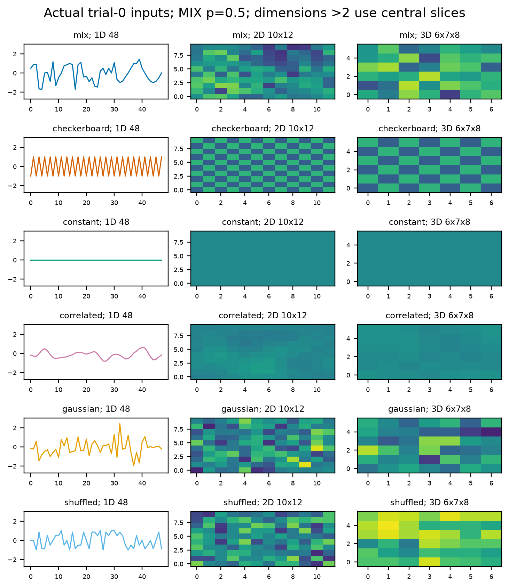
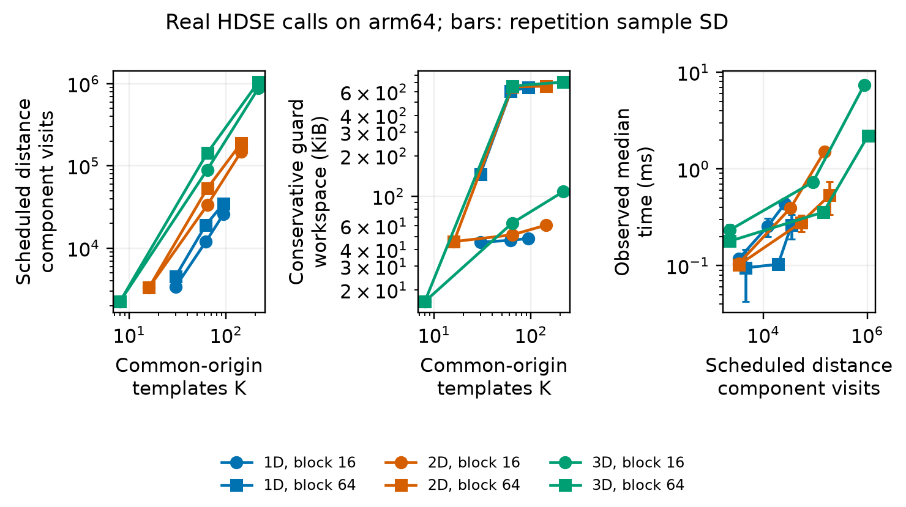
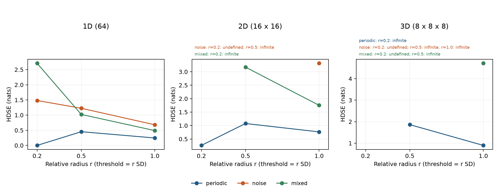
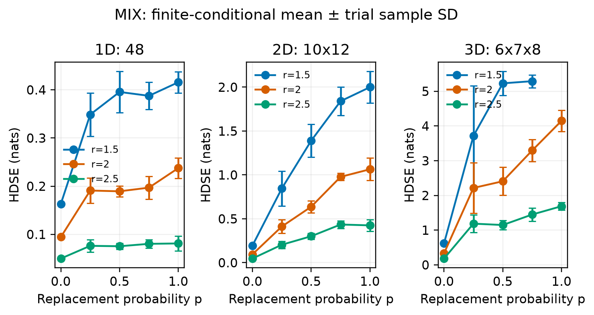
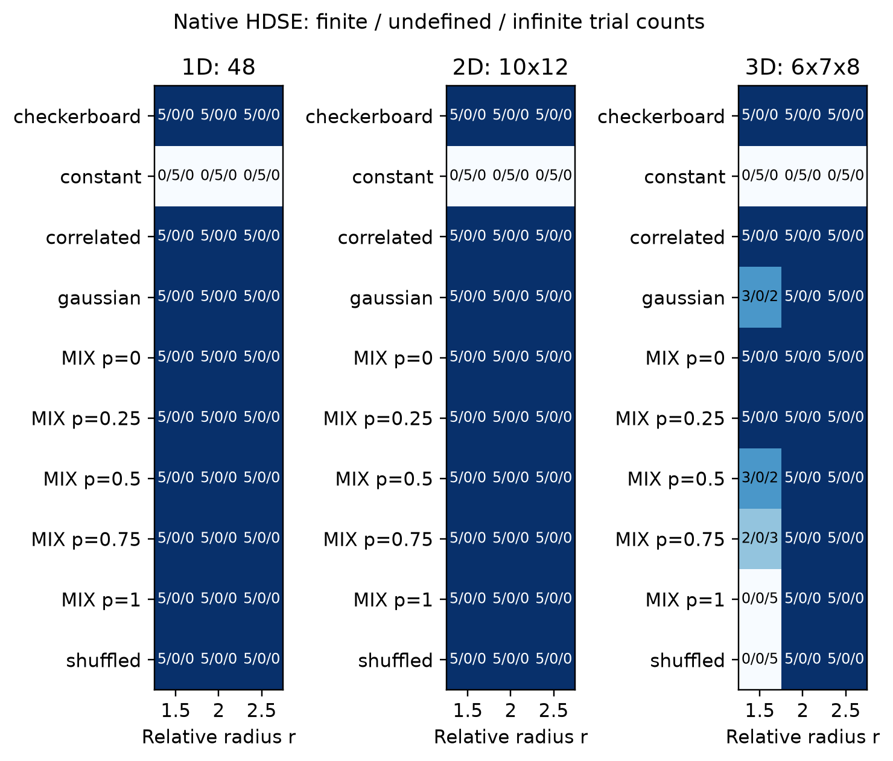
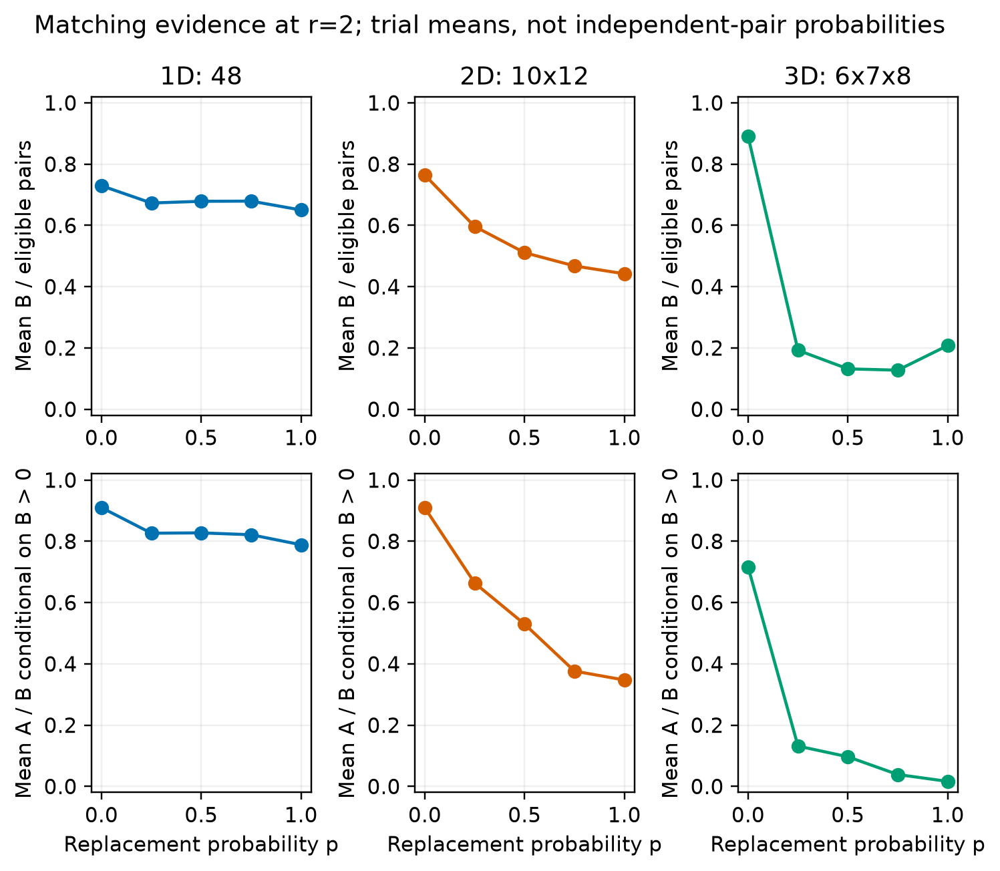
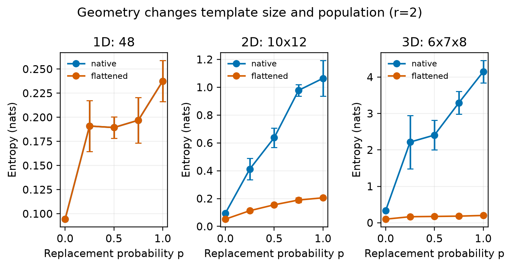
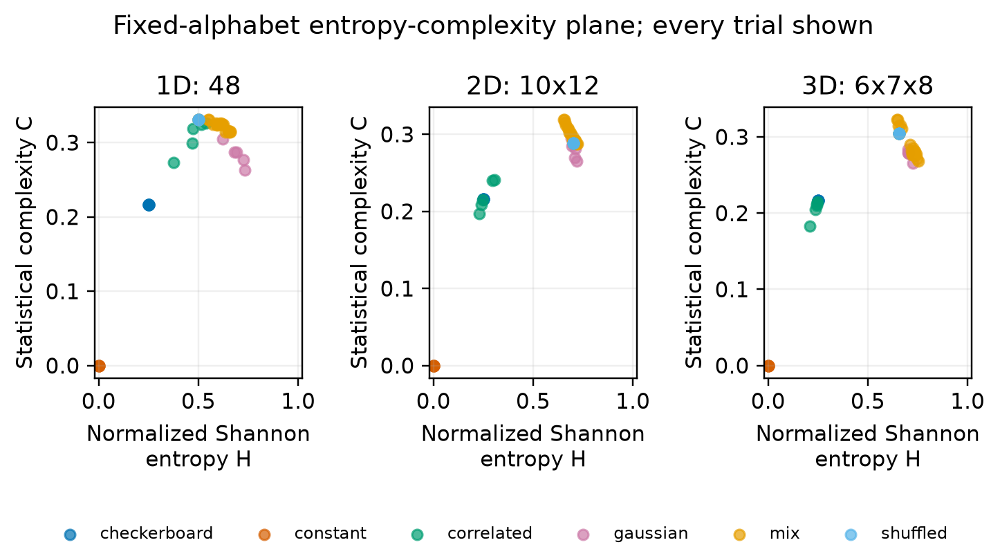

# Abstract {.unnumbered}

antropy: native multidimensional entropy and configurable complexity analysis provides a configurable framework for native spatial entropy,
probability information, ordinal patterns, spectral distributions and trajectory
structure. The implementation separates local spatial extraction from pair
selection and estimator semantics. A common typed result preserves finite,
undefined and infinite outcomes instead of collapsing them into missing numeric
values. This manuscript accompanies antropy-hd 0.3.0.

The retained baseline contains 54 measured rows. The configured
replicated study contains 150 fields and 1650 scalar
estimates, including native HDSE, row-major flattened sample entropy and a
fixed-alphabet entropy-complexity plane. Its field sizes are 48, 10 x 12, 6 x 7 x 8,
with 5 independent generated trials per condition. Analytical
work estimates report actual blocked-kernel schedules; empirical runtimes retain
their host and repetition metadata. Source variables, figures and tables are
generated from the stored reports and validated configuration.

A separate prospective simulation retains 18432 whole-field estimator records, 6912 inference decisions and 108 operating-characteristic cells. The configured procedure compares 4 estimators under holm multiplicity control at significance level 0.05, with pointwise 0.95 confidence intervals. Availability and selected rejection retain separate denominators; these synthetic operating characteristics do not certify a scientific sample size.

The published HDSE construction motivates the local-template estimator, while
the manuscript distinguishes source conventions, ambiguities and explicit
extensions. The experiments are controlled synthetic demonstrations rather than
a reproduction of the source paper's empirical classification results. Rendering
uses the pinned shared research template's Pandoc, LaTeX, bibliography and real
table-of-contents pipeline.


# Introduction {#sec:introduction}

Entropy is a family of questions about a specified representation, population
and uncertainty model. A probability entropy asks about masses over an alphabet.
A sample-template estimator asks how frequently similar local configurations
remain similar after their representation is extended. Ordinal and spectral
estimators construct different distributions. Their outputs require the input
meaning, units, normalization and finite-sample convention to remain visible.

Native multidimensional data make these distinctions especially consequential.
A spatial field has coordinate adjacency along several axes. Globally flattening
it changes which values become adjacent in a one-dimensional embedding. Native
HDSE extracts rectangular local blocks before their values are arranged for
distance computation [@xia2026hdse]. The mathematical estimator and the file
representation are therefore distinct layers.

The repository name combines entropy and ant, reflecting interest in collective
biological organization. No biological observations are included in the present
study. The distribution and Python import use the separate names
`antropy-hd` and `antropy_hd` to preserve compatibility with the unrelated
AntroPy time-series library. The current registry exposes 19
orchestratable entries, while the numerical API also exposes reusable geometry,
information and cost-estimation components.

The project has four connected aims: state estimator contracts precisely;
preserve native geometry and explicit degeneracy; produce a replicated synthetic
study with complete result coverage; and bind measured outputs to executable,
resource-aware software and a configurable manuscript. The source repository is
[the configured public project](https://github.com/docxology/antropy).


# Scope and related work {#sec:scope}

Shannon's discrete entropy defines information over a probability alphabet
[@shannon1948]. Renyi and Tsallis generalize that functional while changing its
order or extensivity conventions [@renyi1961; @tsallis1988]. Joint entropy,
conditional entropy and mutual information retain the variable-axis meanings
of probability tensors. Jensen-Shannon divergence compares distributions over a
shared alphabet [@lin1991]. These identities do not choose an amplitude
discretization or establish a spatial embedding.

Approximate entropy and sample entropy make local-pattern continuation central
[@pincus1991; @richman2000]. HDSE extends local sample-template reasoning to
higher-dimensional fields [@xia2026hdse]. Fuzzy entropy replaces a discontinuous
threshold indicator with a specified similarity kernel [@chen2007]. Multiscale
entropy asks related questions after coarse graining [@costa2002]. Distribution
entropy summarizes the empirical distribution of template distances
[@li2015distribution].

Permutation entropy constructs ordinal-pattern probabilities, with weighted
permutation entropy retaining local amplitude variability [@bandt2002;
@fadlallah2013]. Spectral and trajectory decompositions provide additional
representations [@rezek1998; @broomhead1986]. The implementation uses a full
multidimensional FFT periodogram and normalized singular values; neither
convention is assumed identical to every spectral or SVD estimator in use.

Statistical complexity combines normalized entropy with disequilibrium. Here the
Jensen-Shannon construction follows Rosso and colleagues and the broader family
described by Martin and colleagues [@rosso2007; @martin2006]. Fixed-bin amplitude
probabilities are a declared descriptive extension. This study does not infer
Bandt-Pompe causality or diagnose noise versus chaos from those amplitudes.

The unified framework is an engineering and mathematical organization of these
contracts. It does not assert that the estimators define one calibrated scalar
ordering of complexity. Native HDSE versus flattened SampEn also changes feature
count and extension geometry; that comparison is not a controlled intervention
on flattening alone.


# Methodology {#sec:methodology}

## Complete registered interface

The following table is generated from the current executable registry and
call signatures. Arguments select mathematical conventions and resource limits;
all numerical claims use the effective configuration recorded with each result.
Input probabilities and raw field observations have separate meanings.

| Registered estimator | Input meaning | Configured arguments |
|---|---|---|
| approximate entropy | observations | embedding, match |
| conditional entropy | joint probabilities | conditioned axes, base |
| distribution entropy | observations | embedding, match, bins, normalize |
| fuzzy entropy | observations | embedding, match, power, center |
| hdse | observations | embedding, match |
| histogram entropy | observations | bins, base, max bins |
| jensen shannon divergence | probabilities; q supplied as parameter | q, weight, base |
| joint entropy | joint probabilities | base |
| multiscale entropy | observations | scales, embedding, match, preserve tolerance |
| mutual information | joint probabilities | x axes, base |
| permutation entropy | observations | embedding, weighted, base, normalize, max pattern length |
| renyi entropy | probabilities | order, base, normalize |
| sample entropy | observations | embedding, match |
| shannon entropy | probabilities | base, normalize |
| spectral entropy | observations | demean, include dc, base, normalize, max memory bytes |
| statistical complexity | fixed-alphabet probabilities | config |
| svd entropy | observations | embedding, demean, base, normalize |
| tsallis entropy | probabilities | order, normalize |
| weighted permutation entropy | observations | embedding, base, normalize, max pattern length |

## Native spatial templates

Let $x$ be a finite real-valued array with axis lengths
$\boldsymbol L=(L_1,\ldots,L_d)$. An embedding specifies block shape
$\boldsymbol m$, delays $\boldsymbol\delta$, strides $\boldsymbol s$ and
extension axes. For an origin $\boldsymbol i$, the local template contains
$x_{\boldsymbol i+\boldsymbol k\odot\boldsymbol\delta}$ for
$0\leq k_j<m_j$. Only this extracted block is flattened, in C order. Its
feature count is $q=\prod_jm_j$.

Write $\boldsymbol m^+$ for the extended shape. Common origins are chosen from
the geometry supporting that extended block, so the paired population has

$$
n=\prod_{j=1}^{d}\max\!\left(0,
1+\left\lfloor\frac{L_j-1-(m_j^+-1)\delta_j}{s_j}\right\rfloor\right).
$$ {#eq:origins}

The numerical boundary rejects nonfinite, complex, boolean, string, object,
empty and scalar inputs. Geometry and resource failures raise typed errors.
Rectangular shapes, selected extension axes, delays and strides are explicit
extensions of the paper's common isotropic window construction.

## High-dimensional sample entropy

For paired base and extended templates, use the same admissible unordered origin
pair set $\mathcal P$. With Chebyshev distance
$D_\infty(u,v)=\max_k|u_k-v_k|$ and threshold $\tau=r\sigma_x$, define

$$
B=\sum_{(i,j)\in\mathcal P}\mathbf 1\{D_\infty(u_i,u_j)<\tau\},\qquad
A=\sum_{(i,j)\in\mathcal P}\mathbf 1\{D_\infty(u_i^+,u_j^+)<\tau\}.
$$ {#eq:matches}

When $B>0$ and $A>0$,

$$\operatorname{HDSE}(x)=-\ln(A/B).$$ {#eq:hdse}

The implementation counts unordered pairs; doubling numerator and denominator
recovers the corresponding ordered symmetric counting convention. The standard
deviation is computed over the complete input, with population variance by
default because the source does not specify the degrees-of-freedom convention.
Strict thresholding follows the published HDSE definition [@xia2026hdse].

The paper's prose requiring every origin coordinate to differ and its equations
excluding only the identical origin tuple produce distinct populations.
Ordinary tuple self-exclusion is the default. Coordinate exclusion is exposed
as a documented sensitivity choice, along with Theiler exclusions and other
distance norms. For HDSE, $B=0$ is undefined; $B>0,A=0$ is infinite. A constant
field has zero relative threshold, so strict matching yields no matches even
when its amplitudes are identical.

The executable procedure is:

1. Parse the real array and immutable configuration.
2. Resolve common valid origins and guard template/pair storage.
3. Extract native base and extended windows on those origins.
4. Resolve global tolerance once from the declared standard deviation.
5. Count both representations with the same pair-selection policy.
6. Return value, status, populations, matching counts and effective parameters.

## Related local-template estimators

One-dimensional SampEn uses the same paired engine with its separately declared
boundary convention [@richman2000]. Approximate entropy uses complete, separate
origin populations at each block size and includes self matches. Its statistic
is $\phi_m-\phi_{m+1}$, where
$\phi_m=n_m^{-1}\sum_i\ln C_i^{(m)}$ [@pincus1991]. These populations and
normalizers are not substituted into HDSE.

Fuzzy entropy uses the explicit kernel
$K(D)=\exp[-(D/\tau)^p]$, optionally centering each template, and accumulates
membership sums in the log domain [@chen2007]. Centering changes template
semantics, so fuzzy continuation need not share all monotonicity properties of
un-centered threshold counts. Nonfinite eligible distances or log weights raise
a numerical-range error rather than becoming mathematical undefined estimates.
Its statistic is the difference between the logarithms of mean base and
extended pair memberships, with the same declared pair-selection policy.

Multiscale analysis uses trimmed block means at the configured scale vector
[@costa2002]. Original-input tolerance is preserved by default. Distribution
entropy uses a specified histogram of pairwise distances; using all valid local
origins, including the final valid origin omitted by the original DistEn
construction, is explicitly an implementation extension [@li2015distribution].

For scale vector $\boldsymbol c$, coarse-grained observations are

$$
y_{\boldsymbol\ell}=\frac{1}{\prod_jc_j}
\sum_{0\leq u_j<c_j}x_{\boldsymbol\ell\odot\boldsymbol c+\boldsymbol u}.
$$ {#eq:coarse-grain}

Partial outer blocks are trimmed. The implementation evaluates HDSE at each
coarse-grained level, extending the original one-dimensional multiscale
construction to native spatial fields. Distribution entropy instead forms
probabilities from the histogram of eligible pair distances:
$H_D=-\sum_{k=1}^{K}p_k\ln p_k$, optionally divided by $\ln K$ for $K>1$.

## Probability, ordinal and decomposition estimators

For a declared probability alphabet of size $M$,

$$H_b(P)=-\sum_{a=1}^{M}p_a\log_b p_a,$$ {#eq:shannon}

with zero-mass terms contributing zero. Renyi entropy is
$\log_b(\sum_a p_a^\alpha)/(1-\alpha)$, with explicit support-size, Shannon
and min-entropy limits. Tsallis entropy is
$(1-\sum_a p_a^\alpha)/(\alpha-1)$ with $k=1$ and a natural-log Shannon
limit [@renyi1961; @tsallis1988]. Conditional entropy and mutual information use
the named tensor-axis partitions, not the spatial-axis interpretation of an
amplitude field.

For a joint probability array $P_{X,Y}$, marginalization sums over the declared
complementary axes. The joint entropy is the Shannon entropy of the complete
joint alphabet. The implemented identities are

$$
H_b(X\mid Y)=H_b(X,Y)-H_b(Y),\qquad
I_b(X;Y)=H_b(X)+H_b(Y)-H_b(X,Y).
$$ {#eq:information-identities}

Amplitude histogram entropy first constructs probabilities from the configured
bins and every observed amplitude, then applies $H_b$. Bin edges that exclude
observed amplitudes are rejected rather than silently truncating the field.
For two distributions on the same alphabet, the configurable weighted
Jensen-Shannon divergence is

$$
J_{b,w}(P,Q)=H_b(wP+(1-w)Q)-wH_b(P)-(1-w)H_b(Q).
$$ {#eq:weighted-js}

Permutation entropy applies Shannon entropy to local ordinal-pattern
probabilities; equal amplitudes are ordered stably by local C-order position
[@bandt2002]. Its weighted version uses local population variance
[@fadlallah2013]. Spectral entropy normalizes the complete multidimensional FFT
power distribution, retaining conjugate bins individually. SVD entropy
normalizes singular values of the local trajectory matrix without squaring them
[@rezek1998; @broomhead1986]. Units, normalization and alphabet sizes accompany
each result; singleton and zero-energy degeneracies are handled explicitly.

If local windows have patterns $\pi_i$ and population variances $v_i$, weighted
permutation probabilities are $p_\pi=\sum_i v_i\mathbf1\{\pi_i=\pi\}/\sum_i v_i$.
Ordinary permutation probabilities replace these variance weights with unit
weights. Their normalized entropy uses the declared factorial pattern alphabet,
not only the observed patterns. Spectral probabilities are
$p_{\boldsymbol k}=|\mathcal F(x)_{\boldsymbol k}|^2/\sum_{\boldsymbol j}
|\mathcal F(x)_{\boldsymbol j}|^2$, with the configured mean/DC policy. Trajectory
SVD probabilities are $p_i=\sigma_i/\sum_j\sigma_j$ for singular values
$\sigma_i$ of the configured local-window matrix. These constructions apply
Shannon entropy to different representations; equal numerical values do not
imply equal information about spatial structure.

## Jensen-Shannon statistical complexity

Let $P_e$ be uniform on the complete configured alphabet and $\Delta_M$ a point
mass on that same alphabet. The statistic is

$$
C_{JS}(P)=\frac{H_b(P)}{\log_b M}
\frac{J_b(P,P_e)}{J_b(\Delta_M,P_e)},\qquad
J_b(P,Q)=H_b\!\left(\frac{P+Q}{2}\right)-\frac{H_b(P)+H_b(Q)}{2}.
$$ {#eq:statistical}

Zero-probability cells remain in the declared alphabet. A point mass has zero
normalized entropy; a uniform distribution has zero disequilibrium. Their
statistical complexities are therefore zero for different reasons
[@rosso2007; @martin2006]. The final statistic is dimensionless. It complements
entropy rather than acting as its renamed value.

The study's fixed-bin amplitude alphabet has $M-2$ interior intervals and two
overflow cells, giving $M$ total categories. Values below the lower bound or
at least the upper bound remain in the corresponding overflow cell; empty cells
remain in the probability vector. This symbolization is a declared descriptive
extension, not a causal ordinal partition.


# Experimental setup {#sec:experiments}

## Retained baseline

The original implementation demonstration is retained as a distinct dataset.
Its shapes are 64, 16 x 16, 8 x 8 x 8, embedding shape 2,
relative radii 0.2, 0.5, 1 and seed 20261009. It uses periodic,
Gaussian and additive-mixture fields with period 8 and mixture
amplitude 0.35. This smaller demonstration is not pooled
with the replicated study.

## Replicated Bernoulli-replacement design

The main study uses shapes 48, 10 x 12, 6 x 7 x 8, embedding shape
2, relative radii 1.5, 2, 2.5 and mixing probabilities
0, 0.25, 0.5, 0.75, 1. Each condition has 5 generated trials.
The period is 12 and the root seed is 20261009. The complete
consumed design is generated below from the actual stored plan.

| Control | Configured value |
|---|---|
| schema version | 1 |
| seed | 20261009 |
| shapes | [[48], [10, 12], [6, 7, 8]] |
| mixing probabilities | [0.0, 0.25, 0.5, 0.75, 1.0] |
| controls | ["constant", "checkerboard", "gaussian", "correlated", "shuffled"] |
| replicates | 5 |
| radii | [1.5, 2.0, 2.5] |
| period | 12.0 |
| phase origin | 1 |
| embedding shape | 2 |
| gaussian sd | 1.0 |
| correlation steps | 3 |
| symbol range | [-4.0, 4.0] |
| symbol bins | 16 |
| max input elements | 10000 |
| max fields | 200 |
| max distance component visits | 500000000 |
| max templates | 1000 |
| max pairs | 500000 |
| max memory bytes | 134217728 |
| block size | 64 |

The MIX construction follows the source paper's replacement form rather than
the baseline's additive Gaussian mixture [@xia2026hdse]. For coordinate
$\boldsymbol u$,

$$
s(\boldsymbol u)=\sum_{j=1}^{d}\sin(2\pi (u_j+u_0)/T),\qquad
x_p(\boldsymbol u)=(1-\xi_{p,\boldsymbol u})s(\boldsymbol u)
+\xi_{p,\boldsymbol u}\eta_{\boldsymbol u},
$$ {#eq:mix}

where $u_0=1$ is the configured coordinate phase origin,
$\xi$ is Bernoulli with parameter $p$ and $\eta$ is uniform on
$[-\sqrt3,\sqrt3]$. The periodic sum is not divided by $\sqrt d$. Common random
numbers couple the mixing sweep within a trial, while the trial seed schedule
separates generated fields. The design is bounded by explicit template, pair,
input-element and workspace budgets.

Controls are constant, checkerboard, gaussian, correlated, shuffled. The Gaussian scale is 1;
the configured correlation procedure uses 3 steps.
Fixed amplitude symbolization declares 16 cells over
-4.0, 4.0. Complete probability vectors include empty cells.
Input meaning and symbolization policy are therefore part of the recorded
configuration rather than inferred from a plot.

\clearpage

{#fig:inputs width=100% fig-pos=p}

\clearpage

## Geometry and repetition

Native HDSE and row-major flattened SampEn receive the same underlying amplitude
field and relative-radius setting, but their local representations differ. A
native block has $m^d$ base features and an all-axis extension has $(m+1)^d$;
the flattened one-dimensional continuation adds one feature. Origin populations
and continuation dimensions also differ. These are comparison conditions, not
an assumption that the estimators must agree.

Reported means and sample standard deviations condition on finite outcomes.
Every summary separately retains total, finite, undefined and infinite counts.
Generated trials are the unit of variation; overlapping template pairs are not
treated as independent experimental replicates. No significance test or
classification accuracy is inferred from this synthetic design.
Deterministic conditions can produce identical fields across trial identities;
their repeated values do not establish empirical uncertainty.


# Computational complexity and resources {#sec:cost}

For $n$ local templates with $q$ components, explicit extraction requires
$O(nq)$ component work and storage. Exhaustive pair comparison contributes
$O(n^2q)$ distance-component work. Extending all axes replaces $q$ by
$q^+=\prod_j(m_j+1)$, so native-dimensionality changes feature count as well as
the valid-origin population in [@eq:origins]. Flattening changes both quantities.

The implementation processes bounded pair blocks. This controls workspace but
does not remove quadratic total pair work. Its allocation-free estimator reports
the actual scheduled distance cells, component visits, blocks, origin arrays and
conservative guard bytes for the selected request. Distance work can include
cells later excluded by pair masks; admissible pair counts and computed
distance cells are distinct quantities. Exact scheduled counts, asymptotic size
terms and host runtime observations retain separate interpretations.

Identical scheduled-work rows across radius settings are listed once below;
the complete per-analysis estimates remain in the stored complexity report.

Here flat denotes row-major flattened observations; maximum and histogram denote the distance passes.

\begingroup\small\setlength{\tabcolsep}{8pt}

| Input | Stage | $n$ | $q$ | Pairs | Visits | Guard (B) |
|---|---|---:|---:|---:|---:|---:|
| 6 x 7 x 8 | base native | 120 | 8 | 7140 | 86528 | 695936 |
| 6 x 7 x 8 | extended native | 120 | 27 | 7140 | 292032 | 695936 |
| 6 x 7 x 8 | maximum native | 210 | 8 | 21945 | 226848 | 683056 |
| 6 x 7 x 8 | histogram native | 210 | 8 | 21945 | 226848 | 683056 |
| 6 x 7 x 8 | local native | 210 | 8 | 0 | 0 | 85680 |
| 336 | base flat | 334 | 2 | 55611 | 132232 | 675488 |
| 336 | extended flat | 334 | 3 | 55611 | 198348 | 675488 |
| 10 x 12 | base native | 80 | 4 | 3160 | 21504 | 669056 |
| 10 x 12 | extended native | 80 | 9 | 3160 | 48384 | 669056 |
| 10 x 12 | maximum native | 99 | 4 | 4851 | 30244 | 669328 |
| 10 x 12 | histogram native | 99 | 4 | 4851 | 30244 | 669328 |
| 10 x 12 | local native | 99 | 4 | 0 | 0 | 20592 |
| 120 | base flat | 118 | 2 | 6903 | 20936 | 665120 |
| 120 | extended flat | 118 | 3 | 6903 | 31404 | 665120 |
| 48 | base native | 46 | 2 | 1035 | 4232 | 344864 |
| 48 | extended native | 46 | 3 | 1035 | 6348 | 344864 |
| 48 | maximum native | 47 | 2 | 1081 | 4418 | 363784 |
| 48 | histogram native | 47 | 2 | 1081 | 4418 | 363784 |
| 48 | local native | 47 | 2 | 0 | 0 | 7120 |
| 48 | base flat | 46 | 2 | 1035 | 4232 | 344864 |
| 48 | extended flat | 46 | 3 | 1035 | 6348 | 344864 |

\endgroup

Guard bytes cover the controlled template and pair workspace. Caller-owned
input arrays, file loading, standard-deviation temporaries, allocator overhead,
vendor-library workspaces and process resident memory are outside that bound.
The guard must reject infeasible requests; it is not a measurement of process
RSS or a universal memory guarantee.

## Empirical timing observations

The recorded environment is Python 3.14.7, NumPy 2.5.3, macOS-27.0.1-arm64-arm-64bit-Mach-O, machine arm64. The configured plan uses 1 warmups and 3 measured repetitions per request; block sizes are 16, 64.

| Shape | Block | Median (s) | Sample SD (s) | Visits | Guard (B) |
|---|---|---|---|---|---|
| 4 x 4 x 4 | 16 | 0.000233416 | 3.24125e-05 | 2240 | 16768 |
| 4 x 4 x 4 | 64 | 0.000179125 | 6.43296e-06 | 2240 | 16768 |
| 6 x 6 | 16 | 0.000105208 | 2.92041e-06 | 3328 | 46976 |
| 6 x 6 | 64 | 0.000101584 | 4.27311e-06 | 3328 | 46976 |
| 6 x 6 x 6 | 16 | 0.000730875 | 4.06458e-06 | 89600 | 64512 |
| 6 x 6 x 6 | 64 | 0.000358125 | 3.68909e-06 | 143360 | 678912 |
| 8 x 8 x 8 | 16 | 0.00741188 | 0.000489106 | 875840 | 110720 |
| 8 x 8 x 8 | 64 | 0.00221696 | 0.000139051 | 1041600 | 725120 |
| 10 x 10 | 16 | 0.000394875 | 2.604e-05 | 33280 | 52736 |
| 10 x 10 | 64 | 0.000279375 | 5.43607e-05 | 53248 | 667136 |
| 14 x 14 | 16 | 0.00151417 | 8.36652e-05 | 149760 | 62336 |
| 14 x 14 | 64 | 0.000536333 | 0.000197742 | 189696 | 676736 |
| 32 | 16 | 0.000118458 | 8.8355e-06 | 3380 | 46496 |
| 32 | 64 | 9.5167e-05 | 5.26603e-05 | 4500 | 149536 |
| 64 | 16 | 0.00025375 | 5.37063e-05 | 12020 | 48032 |
| 64 | 64 | 0.000103292 | 3.42341e-06 | 19220 | 622112 |
| 96 | 16 | 0.000437917 | 8.76008e-06 | 25780 | 49568 |
| 96 | 64 | 0.000261333 | 7.39915e-05 | 34580 | 663968 |

{#fig:cost width=100%}

Timings are observed on the recorded environment and inputs. They do not prove
an asymptotic theorem or promise portable latency. Block size can change
workspace, call scheduling and runtime without changing the mathematical pair
population or estimator value. Numerical validity, analytical cost and measured
runtime are therefore checked and reported independently.


# Computational results {#sec:results}

## Baseline outcomes

The baseline records 54 estimates: 45 finite,
3 undefined and 6 infinite. Its HDSE
values are displayed directly from the stored CSV.

| Shape | Field | $r$ | HDSE (nats) | Status |
|---|---|---|---|---|
| 64 | periodic | 0.2 | 0 | finite |
| 64 | periodic | 0.5 | 0.451985 | finite |
| 64 | periodic | 1 | 0.245482 | finite |
| 64 | noise | 0.2 | 1.4816 | finite |
| 64 | noise | 0.5 | 1.22536 | finite |
| 64 | noise | 1 | 0.680827 | finite |
| 64 | mixed | 0.2 | 2.70805 | finite |
| 64 | mixed | 0.5 | 1.02233 | finite |
| 64 | mixed | 1 | 0.488638 | finite |
| 16x16 | periodic | 0.2 | 0.262364 | finite |
| 16x16 | periodic | 0.5 | 1.07654 | finite |
| 16x16 | periodic | 1 | 0.765302 | finite |
| 16x16 | noise | 0.2 | - | undefined |
| 16x16 | noise | 0.5 | - | infinite |
| 16x16 | noise | 1 | 3.31381 | finite |
| 16x16 | mixed | 0.2 | - | infinite |
| 16x16 | mixed | 0.5 | 3.17109 | finite |
| 16x16 | mixed | 1 | 1.75318 | finite |
| 8x8x8 | periodic | 0.2 | - | infinite |
| 8x8x8 | periodic | 0.5 | 1.86322 | finite |
| 8x8x8 | periodic | 1 | 0.898039 | finite |
| 8x8x8 | noise | 0.2 | - | undefined |
| 8x8x8 | noise | 0.5 | - | infinite |
| 8x8x8 | noise | 1 | - | infinite |
| 8x8x8 | mixed | 0.2 | - | undefined |
| 8x8x8 | mixed | 0.5 | - | infinite |
| 8x8x8 | mixed | 1 | 4.71253 | finite |

{#fig:baseline width=100%}

## Replicated native HDSE

The replicated report contains 150 fields and 1650
estimates: 1528 finite, 105 undefined and
17 infinite. The tables retain the finite conditional mean and
sample SD, the finite fraction and the undefined/infinite counts (U/I). A dash
indicates an unavailable finite mean or SD; it does not denote zero entropy.

| Shape | $p$ | $r$ | Mean | SD | Finite/n | U/I |
|---|---|---|---|---|---|---|
| 6x7x8 | 0 | 1.5 | 0.620344 | 0 | 5/5 | 0/0 |
| 6x7x8 | 0 | 2 | 0.334022 | 0 | 5/5 | 0/0 |
| 6x7x8 | 0 | 2.5 | 0.181913 | 0 | 5/5 | 0/0 |
| 6x7x8 | 0.25 | 1.5 | 3.71297 | 1.44226 | 5/5 | 0/0 |
| 6x7x8 | 0.25 | 2 | 2.21524 | 0.731486 | 5/5 | 0/0 |
| 6x7x8 | 0.25 | 2.5 | 1.18716 | 0.254853 | 5/5 | 0/0 |
| 6x7x8 | 0.5 | 1.5 | 5.22817 | 0.343375 | 3/5 | 0/2 |
| 6x7x8 | 0.5 | 2 | 2.40793 | 0.402156 | 5/5 | 0/0 |
| 6x7x8 | 0.5 | 2.5 | 1.14763 | 0.136496 | 5/5 | 0/0 |
| 6x7x8 | 0.75 | 1.5 | 5.2898 | 0.184894 | 2/5 | 0/3 |
| 6x7x8 | 0.75 | 2 | 3.29457 | 0.316691 | 5/5 | 0/0 |
| 6x7x8 | 0.75 | 2.5 | 1.44975 | 0.191395 | 5/5 | 0/0 |
| 6x7x8 | 1 | 1.5 | - | - | 0/5 | 0/5 |
| 6x7x8 | 1 | 2 | 4.14886 | 0.305753 | 5/5 | 0/0 |
| 6x7x8 | 1 | 2.5 | 1.68958 | 0.112868 | 5/5 | 0/0 |
| 10x12 | 0 | 1.5 | 0.195222 | 0 | 5/5 | 0/0 |
| 10x12 | 0 | 2 | 0.0950618 | 0 | 5/5 | 0/0 |
| 10x12 | 0 | 2.5 | 0.0471768 | 0 | 5/5 | 0/0 |
| 10x12 | 0.25 | 1.5 | 0.845984 | 0.198192 | 5/5 | 0/0 |
| 10x12 | 0.25 | 2 | 0.412154 | 0.0775165 | 5/5 | 0/0 |
| 10x12 | 0.25 | 2.5 | 0.204453 | 0.0403457 | 5/5 | 0/0 |
| 10x12 | 0.5 | 1.5 | 1.39016 | 0.187022 | 5/5 | 0/0 |
| 10x12 | 0.5 | 2 | 0.637592 | 0.0698127 | 5/5 | 0/0 |
| 10x12 | 0.5 | 2.5 | 0.301306 | 0.0347635 | 5/5 | 0/0 |
| 10x12 | 0.75 | 1.5 | 1.84024 | 0.161139 | 5/5 | 0/0 |
| 10x12 | 0.75 | 2 | 0.977935 | 0.0408192 | 5/5 | 0/0 |
| 10x12 | 0.75 | 2.5 | 0.434886 | 0.0426958 | 5/5 | 0/0 |
| 10x12 | 1 | 1.5 | 2.00003 | 0.179567 | 5/5 | 0/0 |
| 10x12 | 1 | 2 | 1.06436 | 0.127857 | 5/5 | 0/0 |
| 10x12 | 1 | 2.5 | 0.425303 | 0.0656491 | 5/5 | 0/0 |
| 48 | 0 | 1.5 | 0.163193 | 0 | 5/5 | 0/0 |
| 48 | 0 | 2 | 0.0943835 | 0 | 5/5 | 0/0 |
| 48 | 0 | 2.5 | 0.0497278 | 0 | 5/5 | 0/0 |
| 48 | 0.25 | 1.5 | 0.34872 | 0.0451071 | 5/5 | 0/0 |
| 48 | 0.25 | 2 | 0.190946 | 0.0265122 | 5/5 | 0/0 |
| 48 | 0.25 | 2.5 | 0.0761487 | 0.0129646 | 5/5 | 0/0 |
| 48 | 0.5 | 1.5 | 0.395644 | 0.0426951 | 5/5 | 0/0 |
| 48 | 0.5 | 2 | 0.189375 | 0.0111342 | 5/5 | 0/0 |
| 48 | 0.5 | 2.5 | 0.0752926 | 0.00613628 | 5/5 | 0/0 |
| 48 | 0.75 | 1.5 | 0.387622 | 0.0279628 | 5/5 | 0/0 |
| 48 | 0.75 | 2 | 0.196965 | 0.023594 | 5/5 | 0/0 |
| 48 | 0.75 | 2.5 | 0.0802966 | 0.00841765 | 5/5 | 0/0 |
| 48 | 1 | 1.5 | 0.415829 | 0.022104 | 5/5 | 0/0 |
| 48 | 1 | 2 | 0.237607 | 0.0212663 | 5/5 | 0/0 |
| 48 | 1 | 2.5 | 0.0810962 | 0.015752 | 5/5 | 0/0 |

{#fig:mix width=100%}

{#fig:degeneracy width=100%}

Matching probabilities provide another view of these outcomes. A positive base
count followed by zero extended matches gives infinite continuation entropy;
zero base matches give undefined entropy. Increasing native feature count and
changing spatial geometry can therefore affect interpretability even when all
input amplitudes are valid.

{#fig:matches width=100%}

## Structured controls and alternative representations

| Shape | Control | $r$ | Mean | SD | Finite/n | U/I |
|---|---|---|---|---|---|---|
| 6x7x8 | checkerboard | 1.5 | 0 | 0 | 5/5 | 0/0 |
| 6x7x8 | checkerboard | 2 | 0 | 0 | 5/5 | 0/0 |
| 6x7x8 | checkerboard | 2.5 | 0 | 0 | 5/5 | 0/0 |
| 6x7x8 | constant | 1.5 | - | - | 0/5 | 5/0 |
| 6x7x8 | constant | 2 | - | - | 0/5 | 5/0 |
| 6x7x8 | constant | 2.5 | - | - | 0/5 | 5/0 |
| 6x7x8 | correlated | 1.5 | 2.56749 | 0.840728 | 5/5 | 0/0 |
| 6x7x8 | correlated | 2 | 1.37786 | 0.385547 | 5/5 | 0/0 |
| 6x7x8 | correlated | 2.5 | 0.753716 | 0.232607 | 5/5 | 0/0 |
| 6x7x8 | gaussian | 1.5 | 5.65724 | 0.495324 | 3/5 | 0/2 |
| 6x7x8 | gaussian | 2 | 3.3292 | 0.351848 | 5/5 | 0/0 |
| 6x7x8 | gaussian | 2.5 | 1.56662 | 0.232115 | 5/5 | 0/0 |
| 6x7x8 | shuffled | 1.5 | - | - | 0/5 | 0/5 |
| 6x7x8 | shuffled | 2 | 3.35688 | 0.471817 | 5/5 | 0/0 |
| 6x7x8 | shuffled | 2.5 | 1.76955 | 0.302802 | 5/5 | 0/0 |
| 10x12 | checkerboard | 1.5 | 0 | 0 | 5/5 | 0/0 |
| 10x12 | checkerboard | 2 | 0 | 0 | 5/5 | 0/0 |
| 10x12 | checkerboard | 2.5 | 0 | 0 | 5/5 | 0/0 |
| 10x12 | constant | 1.5 | - | - | 0/5 | 5/0 |
| 10x12 | constant | 2 | - | - | 0/5 | 5/0 |
| 10x12 | constant | 2.5 | - | - | 0/5 | 5/0 |
| 10x12 | correlated | 1.5 | 0.662661 | 0.109864 | 5/5 | 0/0 |
| 10x12 | correlated | 2 | 0.367965 | 0.0601135 | 5/5 | 0/0 |
| 10x12 | correlated | 2.5 | 0.185265 | 0.0324345 | 5/5 | 0/0 |
| 10x12 | gaussian | 1.5 | 1.74544 | 0.233531 | 5/5 | 0/0 |
| 10x12 | gaussian | 2 | 0.861448 | 0.128388 | 5/5 | 0/0 |
| 10x12 | gaussian | 2.5 | 0.400276 | 0.0465602 | 5/5 | 0/0 |
| 10x12 | shuffled | 1.5 | 1.79204 | 0.0637443 | 5/5 | 0/0 |
| 10x12 | shuffled | 2 | 0.850403 | 0.0587828 | 5/5 | 0/0 |
| 10x12 | shuffled | 2.5 | 0.409024 | 0.027914 | 5/5 | 0/0 |
| 48 | checkerboard | 1.5 | 0 | 0 | 5/5 | 0/0 |
| 48 | checkerboard | 2 | 0 | 0 | 5/5 | 0/0 |
| 48 | checkerboard | 2.5 | 0 | 0 | 5/5 | 0/0 |
| 48 | constant | 1.5 | - | - | 0/5 | 5/0 |
| 48 | constant | 2 | - | - | 0/5 | 5/0 |
| 48 | constant | 2.5 | - | - | 0/5 | 5/0 |
| 48 | correlated | 1.5 | 0.139492 | 0.0537352 | 5/5 | 0/0 |
| 48 | correlated | 2 | 0.0738259 | 0.0204956 | 5/5 | 0/0 |
| 48 | correlated | 2.5 | 0.0390499 | 0.0114501 | 5/5 | 0/0 |
| 48 | gaussian | 1.5 | 0.354011 | 0.0389952 | 5/5 | 0/0 |
| 48 | gaussian | 2 | 0.172839 | 0.026053 | 5/5 | 0/0 |
| 48 | gaussian | 2.5 | 0.0831918 | 0.0118893 | 5/5 | 0/0 |
| 48 | shuffled | 1.5 | 0.360859 | 0.0357175 | 5/5 | 0/0 |
| 48 | shuffled | 2 | 0.208973 | 0.018994 | 5/5 | 0/0 |
| 48 | shuffled | 2.5 | 0.0736555 | 0.00547319 | 5/5 | 0/0 |

{#fig:geometry width=100%}

The geometry comparison is read together with feature counts and populations.
Neither a difference nor an agreement alone establishes estimator superiority.
The observed tables are specific to the declared synthetic design, radius,
finite sample and block geometry.

## Related entropy and statistical complexity

The recorded normalization options make these related-measure summaries
dimensionless. Display labels are DistEn: distribution entropy; PermEn: permutation; Spectral: spectral; Shannon: shannon; C-JS: statistical complexity.

| Shape | $p$ | Estimator | Finite mean | SD | Finite/n | U/I |
|---|---|---|---|---|---|---|
| 6x7x8 | 0 | DistEn | 0.821272 | 0 | 5/5 | 0/0 |
| 6x7x8 | 0 | PermEn | 0.401562 | 0 | 5/5 | 0/0 |
| 6x7x8 | 0 | Spectral | 0.366254 | 0 | 5/5 | 0/0 |
| 6x7x8 | 0 | Shannon | 0.655986 | 0 | 5/5 | 0/0 |
| 6x7x8 | 0 | C-JS | 0.304078 | 0 | 5/5 | 0/0 |
| 6x7x8 | 0.25 | DistEn | 0.895451 | 0.00818597 | 5/5 | 0/0 |
| 6x7x8 | 0.25 | PermEn | 0.496046 | 0.00286137 | 5/5 | 0/0 |
| 6x7x8 | 0.25 | Spectral | 0.817511 | 0.0262881 | 5/5 | 0/0 |
| 6x7x8 | 0.25 | Shannon | 0.723031 | 0.00469153 | 5/5 | 0/0 |
| 6x7x8 | 0.25 | C-JS | 0.278564 | 0.00207836 | 5/5 | 0/0 |
| 6x7x8 | 0.5 | DistEn | 0.851999 | 0.00667078 | 5/5 | 0/0 |
| 6x7x8 | 0.5 | PermEn | 0.503431 | 0.000895235 | 5/5 | 0/0 |
| 6x7x8 | 0.5 | Spectral | 0.908797 | 0.0156529 | 5/5 | 0/0 |
| 6x7x8 | 0.5 | Shannon | 0.744093 | 0.00724335 | 5/5 | 0/0 |
| 6x7x8 | 0.5 | C-JS | 0.274515 | 0.00490519 | 5/5 | 0/0 |
| 6x7x8 | 0.75 | DistEn | 0.829532 | 0.00809795 | 5/5 | 0/0 |
| 6x7x8 | 0.75 | PermEn | 0.503852 | 0.000556784 | 5/5 | 0/0 |
| 6x7x8 | 0.75 | Spectral | 0.923803 | 0.00685935 | 5/5 | 0/0 |
| 6x7x8 | 0.75 | Shannon | 0.727915 | 0.00931895 | 5/5 | 0/0 |
| 6x7x8 | 0.75 | C-JS | 0.28245 | 0.00532371 | 5/5 | 0/0 |
| 6x7x8 | 1 | DistEn | 0.813712 | 0.00826181 | 5/5 | 0/0 |
| 6x7x8 | 1 | PermEn | 0.503478 | 0.000811645 | 5/5 | 0/0 |
| 6x7x8 | 1 | Spectral | 0.923819 | 0.00686466 | 5/5 | 0/0 |
| 6x7x8 | 1 | Shannon | 0.657322 | 0.00954592 | 5/5 | 0/0 |
| 6x7x8 | 1 | C-JS | 0.317542 | 0.00516416 | 5/5 | 0/0 |
| 10x12 | 0 | DistEn | 0.9211 | 0 | 5/5 | 0/0 |
| 10x12 | 0 | PermEn | 0.630036 | 0 | 5/5 | 0/0 |
| 10x12 | 0 | Spectral | 0.322933 | 0 | 5/5 | 0/0 |
| 10x12 | 0 | Shannon | 0.702175 | 0 | 5/5 | 0/0 |
| 10x12 | 0 | C-JS | 0.288771 | 0 | 5/5 | 0/0 |
| 10x12 | 0.25 | DistEn | 0.919696 | 0.0121944 | 5/5 | 0/0 |
| 10x12 | 0.25 | PermEn | 0.918879 | 0.0172518 | 5/5 | 0/0 |
| 10x12 | 0.25 | Spectral | 0.659491 | 0.0456326 | 5/5 | 0/0 |
| 10x12 | 0.25 | Shannon | 0.712075 | 0.00929196 | 5/5 | 0/0 |
| 10x12 | 0.25 | C-JS | 0.288816 | 0.00161396 | 5/5 | 0/0 |
| 10x12 | 0.5 | DistEn | 0.895524 | 0.0103245 | 5/5 | 0/0 |
| 10x12 | 0.5 | PermEn | 0.943309 | 0.0145696 | 5/5 | 0/0 |
| 10x12 | 0.5 | Spectral | 0.827952 | 0.0306717 | 5/5 | 0/0 |
| 10x12 | 0.5 | Shannon | 0.704415 | 0.00672185 | 5/5 | 0/0 |
| 10x12 | 0.5 | C-JS | 0.293462 | 0.00222378 | 5/5 | 0/0 |
| 10x12 | 0.75 | DistEn | 0.884852 | 0.00745327 | 5/5 | 0/0 |
| 10x12 | 0.75 | PermEn | 0.96377 | 0.00709848 | 5/5 | 0/0 |
| 10x12 | 0.75 | Spectral | 0.902698 | 0.0121331 | 5/5 | 0/0 |
| 10x12 | 0.75 | Shannon | 0.683502 | 0.0056531 | 5/5 | 0/0 |
| 10x12 | 0.75 | C-JS | 0.302502 | 0.00211954 | 5/5 | 0/0 |
| 10x12 | 1 | DistEn | 0.895472 | 0.00992491 | 5/5 | 0/0 |
| 10x12 | 1 | PermEn | 0.965971 | 0.00735781 | 5/5 | 0/0 |
| 10x12 | 1 | Spectral | 0.91021 | 0.0134747 | 5/5 | 0/0 |
| 10x12 | 1 | Shannon | 0.66164 | 0.00852925 | 5/5 | 0/0 |
| 10x12 | 1 | C-JS | 0.31495 | 0.00483384 | 5/5 | 0/0 |
| 48 | 0 | DistEn | 0.909918 | 0 | 5/5 | 0/0 |
| 48 | 0 | PermEn | 0.999673 | 0 | 5/5 | 0/0 |
| 48 | 0 | Spectral | 0.179052 | 0 | 5/5 | 0/0 |
| 48 | 0 | Shannon | 0.5 | 0 | 5/5 | 0/0 |
| 48 | 0 | C-JS | 0.331184 | 0 | 5/5 | 0/0 |
| 48 | 0.25 | DistEn | 0.915257 | 0.00752288 | 5/5 | 0/0 |
| 48 | 0.25 | PermEn | 0.993391 | 0.0035118 | 5/5 | 0/0 |
| 48 | 0.25 | Spectral | 0.777561 | 0.0341609 | 5/5 | 0/0 |
| 48 | 0.25 | Shannon | 0.578943 | 0.0354646 | 5/5 | 0/0 |
| 48 | 0.25 | C-JS | 0.325202 | 0.00666305 | 5/5 | 0/0 |
| 48 | 0.5 | DistEn | 0.929259 | 0.00851251 | 5/5 | 0/0 |
| 48 | 0.5 | PermEn | 0.986552 | 0.00983542 | 5/5 | 0/0 |
| 48 | 0.5 | Spectral | 0.845927 | 0.0531868 | 5/5 | 0/0 |
| 48 | 0.5 | Shannon | 0.613281 | 0.0207336 | 5/5 | 0/0 |
| 48 | 0.5 | C-JS | 0.322901 | 0.00458086 | 5/5 | 0/0 |
| 48 | 0.75 | DistEn | 0.948009 | 0.0133912 | 5/5 | 0/0 |
| 48 | 0.75 | PermEn | 0.993387 | 0.00574809 | 5/5 | 0/0 |
| 48 | 0.75 | Spectral | 0.882617 | 0.0293371 | 5/5 | 0/0 |
| 48 | 0.75 | Shannon | 0.629339 | 0.0270578 | 5/5 | 0/0 |
| 48 | 0.75 | C-JS | 0.320595 | 0.00573027 | 5/5 | 0/0 |
| 48 | 1 | DistEn | 0.958792 | 0.00697917 | 5/5 | 0/0 |
| 48 | 1 | PermEn | 0.999151 | 0.00116918 | 5/5 | 0/0 |
| 48 | 1 | Spectral | 0.880134 | 0.0274742 | 5/5 | 0/0 |
| 48 | 1 | Shannon | 0.63448 | 0.0272821 | 5/5 | 0/0 |
| 48 | 1 | C-JS | 0.318596 | 0.00497193 | 5/5 | 0/0 |

{#fig:statistical width=100%}

The entropy-complexity plane separates distributional uncertainty from distance
to the uniform alphabet. A high normalized entropy and a high statistical
complexity are different conditions. These fixed-amplitude-bin observations
do not carry the causal ordinal interpretation of a Bandt-Pompe analysis.


# Inference and prospective operating characteristics {#sec:power}

## Scientific unit and declared design

Power depends on a specified generating mechanism, estimand, comparison rule and
decision threshold; it is not an intrinsic property of an entropy value. This
simulation evaluates the complete configured procedure using independently
generated whole fields [@morris2019simulation]. Pixels and overlapping template
pairs contribute to an estimator but do not become independent experimental
subjects. A same-probability stochastic scenario provides the null control;
alternative scenarios change the generating replacement probability.

The consumed design uses shapes 32, 8x10, 5x6x7, group sizes 4, 8, 16 and 64 independent outer repetitions per cell, with root seed 20261010. The comparison is independent and two_sided; the configured allocation mode is auto. The significance threshold is 0.05, interval confidence level 0.95 and configured planning target 0.8. Multiplicity policy: holm. The declared estimators are Native HDSE (r=2.5), Native HDSE (r=1.5), Normalized Shannon entropy, Statistical complexity.

| Scenario | Role | First $p$ | Second $p$ |
|---|---|---|---|
| Identical distributions | null | 0.25 | 0.25 |
| Moderate replacement contrast | alternative | 0.25 | 0.5 |
| Large replacement contrast | alternative | 0.25 | 0.75 |

| Control | Configured value |
|---|---|
| schema version | 1 |
| seed | 20261010 |
| shapes | [[32], [8, 10], [5, 6, 7]] |
| sample sizes | [4, 8, 16] |
| repetitions | 64 |
| alpha | 0.05 |
| confidence level | 0.95 |
| target power | 0.8 |
| multiplicity | "holm" |
| period | 12.0 |
| phase origin | 1 |
| symbol range | [-4.0, 4.0] |
| symbol bins | 16 |
| max input elements | 10000 |
| max fields | 20000 |
| max distance component visits | 5000000000 |
| max inference work | 100000000 |
| max pool bytes | 1048576 |
| max report bytes | 95000000 |

| Inference control | Configured value |
|---|---|
| seed | 20261011 |
| pairing | "independent" |
| resamples | 499 |
| max samples | 100 |
| max resampling work | 1000000 |
| alternative | "two_sided" |
| mode | "auto" |
| max exact allocations | 1000 |

### Native HDSE (r=2.5)

Geometry: native; registered measure: `hdse`. Explicit invocation parameters:

```json
{
  "embedding": {
    "max_memory_bytes": 134217728,
    "max_pairs": 500000,
    "max_templates": 1000,
    "shape": 2
  },
  "match": {
    "block_size": 64,
    "tolerance": 2.5
  }
}
```

### Native HDSE (r=1.5)

Geometry: native; registered measure: `hdse`. Explicit invocation parameters:

```json
{
  "embedding": {
    "max_memory_bytes": 134217728,
    "max_pairs": 500000,
    "max_templates": 1000,
    "shape": 2
  },
  "match": {
    "block_size": 64,
    "tolerance": 1.5
  }
}
```

### Normalized Shannon entropy

Geometry: symbols; registered measure: `shannon_entropy`. Explicit invocation parameters:

```json
{
  "normalize": true
}
```

### Statistical complexity

Geometry: symbols; registered measure: `statistical_complexity`. Explicit invocation parameters:

```json
{
  "config": {
    "alphabet_size": 16
  }
}
```

The report retains 1152 stored pools, 18432 whole-field estimator records and 6912 inference decisions: 6336 available and 576 unavailable. It emits 108 operating-characteristic cells. The preflight worst-case binomial Monte Carlo standard-error bound is 0.0625; it is a simulation-precision bound, not a statement of scientific effect precision.

| $n$ | Allocations | Evaluated | Mode | Work | Grid increment |
|---|---|---|---|---|---|
| 4 | 70 | 70 | exact | 560 | 0.0142857 |
| 8 | 12870 | 499 | monte_carlo | 7984 | 0.002 |
| 16 | 601080390 | 499 | monte_carlo | 15968 | 0.002 |

For equal-sized groups with exact two-sided enumeration, every allocation has a distinct complementary allocation with the same absolute contrast. The minimum attainable p-value is at least twice the exact grid increment. Ties can increase it. The first Holm threshold is alpha divided by the declared family size; if even this lower bound exceeds that threshold, no family member can reject. This necessary-condition calculation does not guarantee rejection at other group sizes.

| $n$ | Two-sided p floor | First threshold | Rejection by floor |
|---|---|---|---|
| 4 | 0.0285714 | 0.0125 | precluded |

| Scheduled resource | Count |
|---|---|
| Fields | 18432 |
| Decisions | 6912 |
| Distance component visits | 1971634176 |
| Inference scalar work | 56475648 |
| Peak live pool arrays (bytes) | 53760 |

\begingroup\small

```text
Power plan:   de602e182e541b4a64956b1dc30b661c29ac4f2f4b742a9695de245c80fb2914
Power report: 1e4ff2f8b8a38d3c29916d3d6f905ffb3ebbf240c2f0adfaa6526f2b1b1fb301
```

\endgroup

Sample-size comparisons reuse prefixes of each maximum-size subject pool.
Within a given cell, outer repetitions use separate streams; estimates across
sample sizes and estimators need not be independent. Reported
intervals are pointwise rather than simultaneous confidence bands. The
configured target is a planning input, not a certified sample-size recommendation
or an estimate of post hoc observed power.

## Permutation decisions and multiplicity

For independent field groups, the statistic is the second-group mean minus the
first-group mean. The null assumption is exchangeability of the whole-field
observations under identical generating distributions. The separate paired API
uses within-pair contrasts and exchangeable sign flips; the current field
generator supplies independent groups instead.

With exact enumeration, $p=e/A$ for $e$ inclusive-tail allocations among all $A$
allocations, including the observed allocation. With $B$ sampled allocations,
the Monte Carlo correction is $p=(b+1)/(B+1)$ [@phipson2010permutation]. Inclusive
tails are compared using exact rational contrasts of the stored binary64 inputs;
reporting a floating-point effect does not change the tail decision. The recorded
p-value grid increment need not equal the smallest attainable two-sided p-value,
because complementary allocations can have the same absolute statistic.

When Holm adjustment is selected, ordered p-values use the running maximum
of $(K-i+1)p_{(i)}$, clipped at one and returned to the original order
[@holm1979]. The declared family includes every configured estimator. Unavailable
comparisons keep null observed p-values and cannot reject; a value of one is used
only internally for conservative family bookkeeping. Raw and adjusted rejection
counts remain separate in the producer report.

## Availability, rejection rates and uncertainty

Let $R$ be attempted outer repetitions, $C$ available comparisons, $U=R-C$
unavailable comparisons and $J$ selected rejections. The report distinguishes

$$
\widehat q_{\mathrm{conditional}}=J/C\quad(C>0),\qquad
\widehat q_{\mathrm{procedure}}=J/R,\qquad
\widehat a=C/R.
$$ {#eq:power-denominators}

Conditional rejection is undefined when no comparison is available. The
unconditional rate describes the implemented procedure that declines to reject
on unavailable comparisons. Under a null scenario it is a false-positive
operating characteristic; under a declared alternative it is a prospective
detection rate. Neither quantity is a biological classification accuracy.

Wilson score intervals quantify binomial Monte Carlo uncertainty at the
configured confidence level [@brown2001interval]. If $\widehat q=J/R$ and $z$ is
the configured normal quantile, their center and half-width are

$$
c=\frac{\widehat q+z^2/(2R)}{1+z^2/R},\qquad
h=\frac{z\sqrt{\widehat q(1-\widehat q)/R+z^2/(4R^2)}}{1+z^2/R}.
$$ {#eq:wilson}

The separate interval conditional on availability uses denominator $C$.
Missing-decision identification bounds $[J/R,(J+U)/R]$ are sensitivity bounds,
not confidence intervals. They show the range obtained by leaving unknown
decisions unresolved rather than imputing zero entropy or deleting a field.

For a true cell rejection probability $q$, the outer simulation standard error
is $\sqrt{q(1-q)/R}$, bounded above by $1/(2\sqrt R)$. This bound concerns
simulation precision. It does not quantify an entropy estimator's bias or
guarantee the configured power target is attained.

### Identical distributions

| Shape | $n$ | Method | Available/R | Rejects/R | Unconditional [CI] |
|---|---|---|---|---|---|
| 5x6x7 | 4 | Native HDSE (r=2.5) | 64/64 | 0/64 | 0 [0, 0.0566241] |
| 5x6x7 | 4 | Native HDSE (r=1.5) | 0/64 | 0/64 | 0 [0, 0.0566241] |
| 5x6x7 | 4 | Normalized Shannon entropy | 64/64 | 0/64 | 0 [0, 0.0566241] |
| 5x6x7 | 4 | Statistical complexity | 64/64 | 0/64 | 0 [0, 0.0566241] |
| 5x6x7 | 8 | Native HDSE (r=2.5) | 64/64 | 4/64 | 0.0625 [0.0245712, 0.149975] |
| 5x6x7 | 8 | Native HDSE (r=1.5) | 0/64 | 0/64 | 0 [0, 0.0566241] |
| 5x6x7 | 8 | Normalized Shannon entropy | 64/64 | 2/64 | 0.03125 [0.00861214, 0.106973] |
| 5x6x7 | 8 | Statistical complexity | 64/64 | 2/64 | 0.03125 [0.00861214, 0.106973] |
| 5x6x7 | 16 | Native HDSE (r=2.5) | 64/64 | 4/64 | 0.0625 [0.0245712, 0.149975] |
| 5x6x7 | 16 | Native HDSE (r=1.5) | 0/64 | 0/64 | 0 [0, 0.0566241] |
| 5x6x7 | 16 | Normalized Shannon entropy | 64/64 | 1/64 | 0.015625 [0.00276354, 0.083341] |
| 5x6x7 | 16 | Statistical complexity | 64/64 | 1/64 | 0.015625 [0.00276354, 0.083341] |
| 8x10 | 4 | Native HDSE (r=2.5) | 64/64 | 0/64 | 0 [0, 0.0566241] |
| 8x10 | 4 | Native HDSE (r=1.5) | 64/64 | 0/64 | 0 [0, 0.0566241] |
| 8x10 | 4 | Normalized Shannon entropy | 64/64 | 0/64 | 0 [0, 0.0566241] |
| 8x10 | 4 | Statistical complexity | 64/64 | 0/64 | 0 [0, 0.0566241] |
| 8x10 | 8 | Native HDSE (r=2.5) | 64/64 | 0/64 | 0 [0, 0.0566241] |
| 8x10 | 8 | Native HDSE (r=1.5) | 64/64 | 0/64 | 0 [0, 0.0566241] |
| 8x10 | 8 | Normalized Shannon entropy | 64/64 | 0/64 | 0 [0, 0.0566241] |
| 8x10 | 8 | Statistical complexity | 64/64 | 0/64 | 0 [0, 0.0566241] |
| 8x10 | 16 | Native HDSE (r=2.5) | 64/64 | 0/64 | 0 [0, 0.0566241] |
| 8x10 | 16 | Native HDSE (r=1.5) | 64/64 | 2/64 | 0.03125 [0.00861214, 0.106973] |
| 8x10 | 16 | Normalized Shannon entropy | 64/64 | 0/64 | 0 [0, 0.0566241] |
| 8x10 | 16 | Statistical complexity | 64/64 | 2/64 | 0.03125 [0.00861214, 0.106973] |
| 32 | 4 | Native HDSE (r=2.5) | 64/64 | 0/64 | 0 [0, 0.0566241] |
| 32 | 4 | Native HDSE (r=1.5) | 64/64 | 0/64 | 0 [0, 0.0566241] |
| 32 | 4 | Normalized Shannon entropy | 64/64 | 0/64 | 0 [0, 0.0566241] |
| 32 | 4 | Statistical complexity | 64/64 | 0/64 | 0 [0, 0.0566241] |
| 32 | 8 | Native HDSE (r=2.5) | 64/64 | 2/64 | 0.03125 [0.00861214, 0.106973] |
| 32 | 8 | Native HDSE (r=1.5) | 64/64 | 0/64 | 0 [0, 0.0566241] |
| 32 | 8 | Normalized Shannon entropy | 64/64 | 0/64 | 0 [0, 0.0566241] |
| 32 | 8 | Statistical complexity | 64/64 | 0/64 | 0 [0, 0.0566241] |
| 32 | 16 | Native HDSE (r=2.5) | 64/64 | 0/64 | 0 [0, 0.0566241] |
| 32 | 16 | Native HDSE (r=1.5) | 64/64 | 1/64 | 0.015625 [0.00276354, 0.083341] |
| 32 | 16 | Normalized Shannon entropy | 64/64 | 1/64 | 0.015625 [0.00276354, 0.083341] |
| 32 | 16 | Statistical complexity | 64/64 | 0/64 | 0 [0, 0.0566241] |

### Moderate replacement contrast

| Shape | $n$ | Method | Available/R | Rejects/R | Unconditional [CI] |
|---|---|---|---|---|---|
| 5x6x7 | 4 | Native HDSE (r=2.5) | 64/64 | 0/64 | 0 [0, 0.0566241] |
| 5x6x7 | 4 | Native HDSE (r=1.5) | 0/64 | 0/64 | 0 [0, 0.0566241] |
| 5x6x7 | 4 | Normalized Shannon entropy | 64/64 | 0/64 | 0 [0, 0.0566241] |
| 5x6x7 | 4 | Statistical complexity | 64/64 | 0/64 | 0 [0, 0.0566241] |
| 5x6x7 | 8 | Native HDSE (r=2.5) | 64/64 | 18/64 | 0.28125 [0.185934, 0.401339] |
| 5x6x7 | 8 | Native HDSE (r=1.5) | 0/64 | 0/64 | 0 [0, 0.0566241] |
| 5x6x7 | 8 | Normalized Shannon entropy | 64/64 | 64/64 | 1 [0.943376, 1] |
| 5x6x7 | 8 | Statistical complexity | 64/64 | 63/64 | 0.984375 [0.916659, 0.997236] |
| 5x6x7 | 16 | Native HDSE (r=2.5) | 64/64 | 33/64 | 0.515625 [0.395816, 0.633664] |
| 5x6x7 | 16 | Native HDSE (r=1.5) | 0/64 | 0/64 | 0 [0, 0.0566241] |
| 5x6x7 | 16 | Normalized Shannon entropy | 64/64 | 64/64 | 1 [0.943376, 1] |
| 5x6x7 | 16 | Statistical complexity | 64/64 | 64/64 | 1 [0.943376, 1] |
| 8x10 | 4 | Native HDSE (r=2.5) | 64/64 | 0/64 | 0 [0, 0.0566241] |
| 8x10 | 4 | Native HDSE (r=1.5) | 64/64 | 0/64 | 0 [0, 0.0566241] |
| 8x10 | 4 | Normalized Shannon entropy | 64/64 | 0/64 | 0 [0, 0.0566241] |
| 8x10 | 4 | Statistical complexity | 64/64 | 0/64 | 0 [0, 0.0566241] |
| 8x10 | 8 | Native HDSE (r=2.5) | 64/64 | 47/64 | 0.734375 [0.615171, 0.827036] |
| 8x10 | 8 | Native HDSE (r=1.5) | 64/64 | 58/64 | 0.90625 [0.810171, 0.956322] |
| 8x10 | 8 | Normalized Shannon entropy | 64/64 | 3/64 | 0.046875 [0.016069, 0.128997] |
| 8x10 | 8 | Statistical complexity | 64/64 | 12/64 | 0.1875 [0.110646, 0.299744] |
| 8x10 | 16 | Native HDSE (r=2.5) | 64/64 | 62/64 | 0.96875 [0.893027, 0.991388] |
| 8x10 | 16 | Native HDSE (r=1.5) | 64/64 | 63/64 | 0.984375 [0.916659, 0.997236] |
| 8x10 | 16 | Normalized Shannon entropy | 64/64 | 3/64 | 0.046875 [0.016069, 0.128997] |
| 8x10 | 16 | Statistical complexity | 64/64 | 31/64 | 0.484375 [0.366336, 0.604184] |
| 32 | 4 | Native HDSE (r=2.5) | 64/64 | 0/64 | 0 [0, 0.0566241] |
| 32 | 4 | Native HDSE (r=1.5) | 64/64 | 0/64 | 0 [0, 0.0566241] |
| 32 | 4 | Normalized Shannon entropy | 64/64 | 0/64 | 0 [0, 0.0566241] |
| 32 | 4 | Statistical complexity | 64/64 | 0/64 | 0 [0, 0.0566241] |
| 32 | 8 | Native HDSE (r=2.5) | 64/64 | 2/64 | 0.03125 [0.00861214, 0.106973] |
| 32 | 8 | Native HDSE (r=1.5) | 64/64 | 13/64 | 0.203125 [0.122734, 0.317136] |
| 32 | 8 | Normalized Shannon entropy | 64/64 | 17/64 | 0.265625 [0.172964, 0.384829] |
| 32 | 8 | Statistical complexity | 64/64 | 3/64 | 0.046875 [0.016069, 0.128997] |
| 32 | 16 | Native HDSE (r=2.5) | 64/64 | 6/64 | 0.09375 [0.0436783, 0.189829] |
| 32 | 16 | Native HDSE (r=1.5) | 64/64 | 42/64 | 0.65625 [0.534036, 0.760769] |
| 32 | 16 | Normalized Shannon entropy | 64/64 | 41/64 | 0.640625 [0.518209, 0.747116] |
| 32 | 16 | Statistical complexity | 64/64 | 7/64 | 0.109375 [0.0540011, 0.208986] |

### Large replacement contrast

| Shape | $n$ | Method | Available/R | Rejects/R | Unconditional [CI] |
|---|---|---|---|---|---|
| 5x6x7 | 4 | Native HDSE (r=2.5) | 64/64 | 0/64 | 0 [0, 0.0566241] |
| 5x6x7 | 4 | Native HDSE (r=1.5) | 0/64 | 0/64 | 0 [0, 0.0566241] |
| 5x6x7 | 4 | Normalized Shannon entropy | 64/64 | 0/64 | 0 [0, 0.0566241] |
| 5x6x7 | 4 | Statistical complexity | 64/64 | 0/64 | 0 [0, 0.0566241] |
| 5x6x7 | 8 | Native HDSE (r=2.5) | 64/64 | 37/64 | 0.578125 [0.4561, 0.691302] |
| 5x6x7 | 8 | Native HDSE (r=1.5) | 0/64 | 0/64 | 0 [0, 0.0566241] |
| 5x6x7 | 8 | Normalized Shannon entropy | 64/64 | 64/64 | 1 [0.943376, 1] |
| 5x6x7 | 8 | Statistical complexity | 64/64 | 48/64 | 0.75 [0.631837, 0.839851] |
| 5x6x7 | 16 | Native HDSE (r=2.5) | 64/64 | 59/64 | 0.921875 [0.829805, 0.966169] |
| 5x6x7 | 16 | Native HDSE (r=1.5) | 0/64 | 0/64 | 0 [0, 0.0566241] |
| 5x6x7 | 16 | Normalized Shannon entropy | 64/64 | 64/64 | 1 [0.943376, 1] |
| 5x6x7 | 16 | Statistical complexity | 64/64 | 64/64 | 1 [0.943376, 1] |
| 8x10 | 4 | Native HDSE (r=2.5) | 64/64 | 0/64 | 0 [0, 0.0566241] |
| 8x10 | 4 | Native HDSE (r=1.5) | 64/64 | 0/64 | 0 [0, 0.0566241] |
| 8x10 | 4 | Normalized Shannon entropy | 64/64 | 0/64 | 0 [0, 0.0566241] |
| 8x10 | 4 | Statistical complexity | 64/64 | 0/64 | 0 [0, 0.0566241] |
| 8x10 | 8 | Native HDSE (r=2.5) | 64/64 | 64/64 | 1 [0.943376, 1] |
| 8x10 | 8 | Native HDSE (r=1.5) | 64/64 | 64/64 | 1 [0.943376, 1] |
| 8x10 | 8 | Normalized Shannon entropy | 64/64 | 25/64 | 0.390625 [0.280556, 0.513081] |
| 8x10 | 8 | Statistical complexity | 64/64 | 61/64 | 0.953125 [0.871003, 0.983931] |
| 8x10 | 16 | Native HDSE (r=2.5) | 64/64 | 64/64 | 1 [0.943376, 1] |
| 8x10 | 16 | Native HDSE (r=1.5) | 64/64 | 64/64 | 1 [0.943376, 1] |
| 8x10 | 16 | Normalized Shannon entropy | 64/64 | 46/64 | 0.71875 [0.598661, 0.814066] |
| 8x10 | 16 | Statistical complexity | 64/64 | 64/64 | 1 [0.943376, 1] |
| 32 | 4 | Native HDSE (r=2.5) | 64/64 | 0/64 | 0 [0, 0.0566241] |
| 32 | 4 | Native HDSE (r=1.5) | 64/64 | 0/64 | 0 [0, 0.0566241] |
| 32 | 4 | Normalized Shannon entropy | 64/64 | 0/64 | 0 [0, 0.0566241] |
| 32 | 4 | Statistical complexity | 64/64 | 0/64 | 0 [0, 0.0566241] |
| 32 | 8 | Native HDSE (r=2.5) | 64/64 | 11/64 | 0.171875 [0.0987774, 0.282132] |
| 32 | 8 | Native HDSE (r=1.5) | 64/64 | 29/64 | 0.453125 [0.337294, 0.574264] |
| 32 | 8 | Normalized Shannon entropy | 64/64 | 48/64 | 0.75 [0.631837, 0.839851] |
| 32 | 8 | Statistical complexity | 64/64 | 8/64 | 0.125 [0.0647224, 0.227746] |
| 32 | 16 | Native HDSE (r=2.5) | 64/64 | 20/64 | 0.3125 [0.212311, 0.433923] |
| 32 | 16 | Native HDSE (r=1.5) | 64/64 | 51/64 | 0.796875 [0.682864, 0.877266] |
| 32 | 16 | Normalized Shannon entropy | 64/64 | 63/64 | 0.984375 [0.916659, 0.997236] |
| 32 | 16 | Statistical complexity | 64/64 | 22/64 | 0.34375 [0.239231, 0.465964] |

\clearpage

{#fig:power-rejection width=100% fig-pos=p}

\clearpage

### Identical distributions

| Shape | $n$ | Method | Availability [CI] | Conditional [CI] | Missing bounds |
|---|---|---|---|---|---|
| 5x6x7 | 4 | Native HDSE (r=2.5) | 1 [0.943376, 1] | 0 [0, 0.0566241] | [0, 0] |
| 5x6x7 | 4 | Native HDSE (r=1.5) | 0 [0, 0.0566241] | undefined | [0, 1] |
| 5x6x7 | 4 | Normalized Shannon entropy | 1 [0.943376, 1] | 0 [0, 0.0566241] | [0, 0] |
| 5x6x7 | 4 | Statistical complexity | 1 [0.943376, 1] | 0 [0, 0.0566241] | [0, 0] |
| 5x6x7 | 8 | Native HDSE (r=2.5) | 1 [0.943376, 1] | 0.0625 [0.0245712, 0.149975] | [0.0625, 0.0625] |
| 5x6x7 | 8 | Native HDSE (r=1.5) | 0 [0, 0.0566241] | undefined | [0, 1] |
| 5x6x7 | 8 | Normalized Shannon entropy | 1 [0.943376, 1] | 0.03125 [0.00861214, 0.106973] | [0.03125, 0.03125] |
| 5x6x7 | 8 | Statistical complexity | 1 [0.943376, 1] | 0.03125 [0.00861214, 0.106973] | [0.03125, 0.03125] |
| 5x6x7 | 16 | Native HDSE (r=2.5) | 1 [0.943376, 1] | 0.0625 [0.0245712, 0.149975] | [0.0625, 0.0625] |
| 5x6x7 | 16 | Native HDSE (r=1.5) | 0 [0, 0.0566241] | undefined | [0, 1] |
| 5x6x7 | 16 | Normalized Shannon entropy | 1 [0.943376, 1] | 0.015625 [0.00276354, 0.083341] | [0.015625, 0.015625] |
| 5x6x7 | 16 | Statistical complexity | 1 [0.943376, 1] | 0.015625 [0.00276354, 0.083341] | [0.015625, 0.015625] |
| 8x10 | 4 | Native HDSE (r=2.5) | 1 [0.943376, 1] | 0 [0, 0.0566241] | [0, 0] |
| 8x10 | 4 | Native HDSE (r=1.5) | 1 [0.943376, 1] | 0 [0, 0.0566241] | [0, 0] |
| 8x10 | 4 | Normalized Shannon entropy | 1 [0.943376, 1] | 0 [0, 0.0566241] | [0, 0] |
| 8x10 | 4 | Statistical complexity | 1 [0.943376, 1] | 0 [0, 0.0566241] | [0, 0] |
| 8x10 | 8 | Native HDSE (r=2.5) | 1 [0.943376, 1] | 0 [0, 0.0566241] | [0, 0] |
| 8x10 | 8 | Native HDSE (r=1.5) | 1 [0.943376, 1] | 0 [0, 0.0566241] | [0, 0] |
| 8x10 | 8 | Normalized Shannon entropy | 1 [0.943376, 1] | 0 [0, 0.0566241] | [0, 0] |
| 8x10 | 8 | Statistical complexity | 1 [0.943376, 1] | 0 [0, 0.0566241] | [0, 0] |
| 8x10 | 16 | Native HDSE (r=2.5) | 1 [0.943376, 1] | 0 [0, 0.0566241] | [0, 0] |
| 8x10 | 16 | Native HDSE (r=1.5) | 1 [0.943376, 1] | 0.03125 [0.00861214, 0.106973] | [0.03125, 0.03125] |
| 8x10 | 16 | Normalized Shannon entropy | 1 [0.943376, 1] | 0 [0, 0.0566241] | [0, 0] |
| 8x10 | 16 | Statistical complexity | 1 [0.943376, 1] | 0.03125 [0.00861214, 0.106973] | [0.03125, 0.03125] |
| 32 | 4 | Native HDSE (r=2.5) | 1 [0.943376, 1] | 0 [0, 0.0566241] | [0, 0] |
| 32 | 4 | Native HDSE (r=1.5) | 1 [0.943376, 1] | 0 [0, 0.0566241] | [0, 0] |
| 32 | 4 | Normalized Shannon entropy | 1 [0.943376, 1] | 0 [0, 0.0566241] | [0, 0] |
| 32 | 4 | Statistical complexity | 1 [0.943376, 1] | 0 [0, 0.0566241] | [0, 0] |
| 32 | 8 | Native HDSE (r=2.5) | 1 [0.943376, 1] | 0.03125 [0.00861214, 0.106973] | [0.03125, 0.03125] |
| 32 | 8 | Native HDSE (r=1.5) | 1 [0.943376, 1] | 0 [0, 0.0566241] | [0, 0] |
| 32 | 8 | Normalized Shannon entropy | 1 [0.943376, 1] | 0 [0, 0.0566241] | [0, 0] |
| 32 | 8 | Statistical complexity | 1 [0.943376, 1] | 0 [0, 0.0566241] | [0, 0] |
| 32 | 16 | Native HDSE (r=2.5) | 1 [0.943376, 1] | 0 [0, 0.0566241] | [0, 0] |
| 32 | 16 | Native HDSE (r=1.5) | 1 [0.943376, 1] | 0.015625 [0.00276354, 0.083341] | [0.015625, 0.015625] |
| 32 | 16 | Normalized Shannon entropy | 1 [0.943376, 1] | 0.015625 [0.00276354, 0.083341] | [0.015625, 0.015625] |
| 32 | 16 | Statistical complexity | 1 [0.943376, 1] | 0 [0, 0.0566241] | [0, 0] |

### Moderate replacement contrast

| Shape | $n$ | Method | Availability [CI] | Conditional [CI] | Missing bounds |
|---|---|---|---|---|---|
| 5x6x7 | 4 | Native HDSE (r=2.5) | 1 [0.943376, 1] | 0 [0, 0.0566241] | [0, 0] |
| 5x6x7 | 4 | Native HDSE (r=1.5) | 0 [0, 0.0566241] | undefined | [0, 1] |
| 5x6x7 | 4 | Normalized Shannon entropy | 1 [0.943376, 1] | 0 [0, 0.0566241] | [0, 0] |
| 5x6x7 | 4 | Statistical complexity | 1 [0.943376, 1] | 0 [0, 0.0566241] | [0, 0] |
| 5x6x7 | 8 | Native HDSE (r=2.5) | 1 [0.943376, 1] | 0.28125 [0.185934, 0.401339] | [0.28125, 0.28125] |
| 5x6x7 | 8 | Native HDSE (r=1.5) | 0 [0, 0.0566241] | undefined | [0, 1] |
| 5x6x7 | 8 | Normalized Shannon entropy | 1 [0.943376, 1] | 1 [0.943376, 1] | [1, 1] |
| 5x6x7 | 8 | Statistical complexity | 1 [0.943376, 1] | 0.984375 [0.916659, 0.997236] | [0.984375, 0.984375] |
| 5x6x7 | 16 | Native HDSE (r=2.5) | 1 [0.943376, 1] | 0.515625 [0.395816, 0.633664] | [0.515625, 0.515625] |
| 5x6x7 | 16 | Native HDSE (r=1.5) | 0 [0, 0.0566241] | undefined | [0, 1] |
| 5x6x7 | 16 | Normalized Shannon entropy | 1 [0.943376, 1] | 1 [0.943376, 1] | [1, 1] |
| 5x6x7 | 16 | Statistical complexity | 1 [0.943376, 1] | 1 [0.943376, 1] | [1, 1] |
| 8x10 | 4 | Native HDSE (r=2.5) | 1 [0.943376, 1] | 0 [0, 0.0566241] | [0, 0] |
| 8x10 | 4 | Native HDSE (r=1.5) | 1 [0.943376, 1] | 0 [0, 0.0566241] | [0, 0] |
| 8x10 | 4 | Normalized Shannon entropy | 1 [0.943376, 1] | 0 [0, 0.0566241] | [0, 0] |
| 8x10 | 4 | Statistical complexity | 1 [0.943376, 1] | 0 [0, 0.0566241] | [0, 0] |
| 8x10 | 8 | Native HDSE (r=2.5) | 1 [0.943376, 1] | 0.734375 [0.615171, 0.827036] | [0.734375, 0.734375] |
| 8x10 | 8 | Native HDSE (r=1.5) | 1 [0.943376, 1] | 0.90625 [0.810171, 0.956322] | [0.90625, 0.90625] |
| 8x10 | 8 | Normalized Shannon entropy | 1 [0.943376, 1] | 0.046875 [0.016069, 0.128997] | [0.046875, 0.046875] |
| 8x10 | 8 | Statistical complexity | 1 [0.943376, 1] | 0.1875 [0.110646, 0.299744] | [0.1875, 0.1875] |
| 8x10 | 16 | Native HDSE (r=2.5) | 1 [0.943376, 1] | 0.96875 [0.893027, 0.991388] | [0.96875, 0.96875] |
| 8x10 | 16 | Native HDSE (r=1.5) | 1 [0.943376, 1] | 0.984375 [0.916659, 0.997236] | [0.984375, 0.984375] |
| 8x10 | 16 | Normalized Shannon entropy | 1 [0.943376, 1] | 0.046875 [0.016069, 0.128997] | [0.046875, 0.046875] |
| 8x10 | 16 | Statistical complexity | 1 [0.943376, 1] | 0.484375 [0.366336, 0.604184] | [0.484375, 0.484375] |
| 32 | 4 | Native HDSE (r=2.5) | 1 [0.943376, 1] | 0 [0, 0.0566241] | [0, 0] |
| 32 | 4 | Native HDSE (r=1.5) | 1 [0.943376, 1] | 0 [0, 0.0566241] | [0, 0] |
| 32 | 4 | Normalized Shannon entropy | 1 [0.943376, 1] | 0 [0, 0.0566241] | [0, 0] |
| 32 | 4 | Statistical complexity | 1 [0.943376, 1] | 0 [0, 0.0566241] | [0, 0] |
| 32 | 8 | Native HDSE (r=2.5) | 1 [0.943376, 1] | 0.03125 [0.00861214, 0.106973] | [0.03125, 0.03125] |
| 32 | 8 | Native HDSE (r=1.5) | 1 [0.943376, 1] | 0.203125 [0.122734, 0.317136] | [0.203125, 0.203125] |
| 32 | 8 | Normalized Shannon entropy | 1 [0.943376, 1] | 0.265625 [0.172964, 0.384829] | [0.265625, 0.265625] |
| 32 | 8 | Statistical complexity | 1 [0.943376, 1] | 0.046875 [0.016069, 0.128997] | [0.046875, 0.046875] |
| 32 | 16 | Native HDSE (r=2.5) | 1 [0.943376, 1] | 0.09375 [0.0436783, 0.189829] | [0.09375, 0.09375] |
| 32 | 16 | Native HDSE (r=1.5) | 1 [0.943376, 1] | 0.65625 [0.534036, 0.760769] | [0.65625, 0.65625] |
| 32 | 16 | Normalized Shannon entropy | 1 [0.943376, 1] | 0.640625 [0.518209, 0.747116] | [0.640625, 0.640625] |
| 32 | 16 | Statistical complexity | 1 [0.943376, 1] | 0.109375 [0.0540011, 0.208986] | [0.109375, 0.109375] |

### Large replacement contrast

| Shape | $n$ | Method | Availability [CI] | Conditional [CI] | Missing bounds |
|---|---|---|---|---|---|
| 5x6x7 | 4 | Native HDSE (r=2.5) | 1 [0.943376, 1] | 0 [0, 0.0566241] | [0, 0] |
| 5x6x7 | 4 | Native HDSE (r=1.5) | 0 [0, 0.0566241] | undefined | [0, 1] |
| 5x6x7 | 4 | Normalized Shannon entropy | 1 [0.943376, 1] | 0 [0, 0.0566241] | [0, 0] |
| 5x6x7 | 4 | Statistical complexity | 1 [0.943376, 1] | 0 [0, 0.0566241] | [0, 0] |
| 5x6x7 | 8 | Native HDSE (r=2.5) | 1 [0.943376, 1] | 0.578125 [0.4561, 0.691302] | [0.578125, 0.578125] |
| 5x6x7 | 8 | Native HDSE (r=1.5) | 0 [0, 0.0566241] | undefined | [0, 1] |
| 5x6x7 | 8 | Normalized Shannon entropy | 1 [0.943376, 1] | 1 [0.943376, 1] | [1, 1] |
| 5x6x7 | 8 | Statistical complexity | 1 [0.943376, 1] | 0.75 [0.631837, 0.839851] | [0.75, 0.75] |
| 5x6x7 | 16 | Native HDSE (r=2.5) | 1 [0.943376, 1] | 0.921875 [0.829805, 0.966169] | [0.921875, 0.921875] |
| 5x6x7 | 16 | Native HDSE (r=1.5) | 0 [0, 0.0566241] | undefined | [0, 1] |
| 5x6x7 | 16 | Normalized Shannon entropy | 1 [0.943376, 1] | 1 [0.943376, 1] | [1, 1] |
| 5x6x7 | 16 | Statistical complexity | 1 [0.943376, 1] | 1 [0.943376, 1] | [1, 1] |
| 8x10 | 4 | Native HDSE (r=2.5) | 1 [0.943376, 1] | 0 [0, 0.0566241] | [0, 0] |
| 8x10 | 4 | Native HDSE (r=1.5) | 1 [0.943376, 1] | 0 [0, 0.0566241] | [0, 0] |
| 8x10 | 4 | Normalized Shannon entropy | 1 [0.943376, 1] | 0 [0, 0.0566241] | [0, 0] |
| 8x10 | 4 | Statistical complexity | 1 [0.943376, 1] | 0 [0, 0.0566241] | [0, 0] |
| 8x10 | 8 | Native HDSE (r=2.5) | 1 [0.943376, 1] | 1 [0.943376, 1] | [1, 1] |
| 8x10 | 8 | Native HDSE (r=1.5) | 1 [0.943376, 1] | 1 [0.943376, 1] | [1, 1] |
| 8x10 | 8 | Normalized Shannon entropy | 1 [0.943376, 1] | 0.390625 [0.280556, 0.513081] | [0.390625, 0.390625] |
| 8x10 | 8 | Statistical complexity | 1 [0.943376, 1] | 0.953125 [0.871003, 0.983931] | [0.953125, 0.953125] |
| 8x10 | 16 | Native HDSE (r=2.5) | 1 [0.943376, 1] | 1 [0.943376, 1] | [1, 1] |
| 8x10 | 16 | Native HDSE (r=1.5) | 1 [0.943376, 1] | 1 [0.943376, 1] | [1, 1] |
| 8x10 | 16 | Normalized Shannon entropy | 1 [0.943376, 1] | 0.71875 [0.598661, 0.814066] | [0.71875, 0.71875] |
| 8x10 | 16 | Statistical complexity | 1 [0.943376, 1] | 1 [0.943376, 1] | [1, 1] |
| 32 | 4 | Native HDSE (r=2.5) | 1 [0.943376, 1] | 0 [0, 0.0566241] | [0, 0] |
| 32 | 4 | Native HDSE (r=1.5) | 1 [0.943376, 1] | 0 [0, 0.0566241] | [0, 0] |
| 32 | 4 | Normalized Shannon entropy | 1 [0.943376, 1] | 0 [0, 0.0566241] | [0, 0] |
| 32 | 4 | Statistical complexity | 1 [0.943376, 1] | 0 [0, 0.0566241] | [0, 0] |
| 32 | 8 | Native HDSE (r=2.5) | 1 [0.943376, 1] | 0.171875 [0.0987774, 0.282132] | [0.171875, 0.171875] |
| 32 | 8 | Native HDSE (r=1.5) | 1 [0.943376, 1] | 0.453125 [0.337294, 0.574264] | [0.453125, 0.453125] |
| 32 | 8 | Normalized Shannon entropy | 1 [0.943376, 1] | 0.75 [0.631837, 0.839851] | [0.75, 0.75] |
| 32 | 8 | Statistical complexity | 1 [0.943376, 1] | 0.125 [0.0647224, 0.227746] | [0.125, 0.125] |
| 32 | 16 | Native HDSE (r=2.5) | 1 [0.943376, 1] | 0.3125 [0.212311, 0.433923] | [0.3125, 0.3125] |
| 32 | 16 | Native HDSE (r=1.5) | 1 [0.943376, 1] | 0.796875 [0.682864, 0.877266] | [0.796875, 0.796875] |
| 32 | 16 | Normalized Shannon entropy | 1 [0.943376, 1] | 0.984375 [0.916659, 0.997236] | [0.984375, 0.984375] |
| 32 | 16 | Statistical complexity | 1 [0.943376, 1] | 0.34375 [0.239231, 0.465964] | [0.34375, 0.34375] |

\clearpage

{#fig:power-availability width=100% fig-pos=p}

\clearpage

## Effect summaries and bootstrap interface

Mean differences retain each estimator's configured units. Their reported means
and sample standard deviations condition on available comparisons; unavailable
effects remain null. Empirical variation among outer repetitions and the
Monte Carlo uncertainty of a rejection proportion are different quantities.

### Identical distributions

\begingroup\small\setlength{\tabcolsep}{8pt}

| Shape | $n$ | Method | Mean $\Delta$ | SD | Raw | Adj. |
|----------|-----:|-------------------------|--------------------:|--------------------:|----------:|----------:|
| 5x6x7 | 4 | Native HDSE (r=2.5) | 0.0079771 | 0.499975 | 6 | 0 |
| 5x6x7 | 4 | Native HDSE (r=1.5) | - | - | 0 | 0 |
| 5x6x7 | 4 | Normalized Shannon entropy | 0.000465629 | 0.00874333 | 0 | 0 |
| 5x6x7 | 4 | Statistical complexity | 8.73969e-05 | 0.00293578 | 1 | 0 |
| 5x6x7 | 8 | Native HDSE (r=2.5) | 0.0110846 | 0.3332 | 5 | 4 |
| 5x6x7 | 8 | Native HDSE (r=1.5) | - | - | 0 | 0 |
| 5x6x7 | 8 | Normalized Shannon entropy | -0.000363409 | 0.00665451 | 4 | 2 |
| 5x6x7 | 8 | Statistical complexity | 0.000327146 | 0.00232198 | 4 | 2 |
| 5x6x7 | 16 | Native HDSE (r=2.5) | 0.00720238 | 0.233063 | 6 | 4 |
| 5x6x7 | 16 | Native HDSE (r=1.5) | - | - | 0 | 0 |
| 5x6x7 | 16 | Normalized Shannon entropy | -0.000233572 | 0.00485811 | 2 | 1 |
| 5x6x7 | 16 | Statistical complexity | 0.000267878 | 0.00160841 | 2 | 1 |
| 8x10 | 4 | Native HDSE (r=2.5) | 0.000128229 | 0.0319748 | 1 | 0 |
| 8x10 | 4 | Native HDSE (r=1.5) | 0.0128598 | 0.162703 | 2 | 0 |
| 8x10 | 4 | Normalized Shannon entropy | -0.00027704 | 0.0113081 | 3 | 0 |
| 8x10 | 4 | Statistical complexity | -0.000342759 | 0.00218425 | 0 | 0 |
| 8x10 | 8 | Native HDSE (r=2.5) | 0.000280026 | 0.0233939 | 2 | 0 |
| 8x10 | 8 | Native HDSE (r=1.5) | 0.00905552 | 0.106368 | 1 | 0 |
| 8x10 | 8 | Normalized Shannon entropy | 0.000518915 | 0.00762356 | 4 | 0 |
| 8x10 | 8 | Statistical complexity | -0.000204289 | 0.00151584 | 2 | 0 |
| 8x10 | 16 | Native HDSE (r=2.5) | 0.00341973 | 0.0179267 | 2 | 0 |
| 8x10 | 16 | Native HDSE (r=1.5) | 0.013453 | 0.0848148 | 2 | 2 |
| 8x10 | 16 | Normalized Shannon entropy | 0.000831496 | 0.00487999 | 4 | 0 |
| 8x10 | 16 | Statistical complexity | -0.000162677 | 0.00112663 | 3 | 2 |
| 32 | 4 | Native HDSE (r=2.5) | 0.00119658 | 0.011672 | 1 | 0 |
| 32 | 4 | Native HDSE (r=1.5) | 0.00980362 | 0.0355917 | 2 | 0 |
| 32 | 4 | Normalized Shannon entropy | -0.00112075 | 0.0209735 | 2 | 0 |
| 32 | 4 | Statistical complexity | 0.000143083 | 0.00264442 | 1 | 0 |
| 32 | 8 | Native HDSE (r=2.5) | 0.00123023 | 0.00742757 | 2 | 2 |
| 32 | 8 | Native HDSE (r=1.5) | 0.00533874 | 0.0222971 | 0 | 0 |
| 32 | 8 | Normalized Shannon entropy | 0.00014562 | 0.013859 | 2 | 0 |
| 32 | 8 | Statistical complexity | 0.000185304 | 0.00164353 | 2 | 0 |
| 32 | 16 | Native HDSE (r=2.5) | 0.000501501 | 0.0053336 | 2 | 0 |
| 32 | 16 | Native HDSE (r=1.5) | 0.00437018 | 0.0208222 | 1 | 1 |
| 32 | 16 | Normalized Shannon entropy | 0.000254737 | 0.0108428 | 1 | 1 |
| 32 | 16 | Statistical complexity | -5.40386e-05 | 0.00141895 | 3 | 0 |

\endgroup

### Moderate replacement contrast

\begingroup\small\setlength{\tabcolsep}{8pt}

| Shape | $n$ | Method | Mean $\Delta$ | SD | Raw | Adj. |
|----------|-----:|-------------------------|--------------------:|--------------------:|----------:|----------:|
| 5x6x7 | 4 | Native HDSE (r=2.5) | -0.401807 | 0.313747 | 7 | 0 |
| 5x6x7 | 4 | Native HDSE (r=1.5) | - | - | 0 | 0 |
| 5x6x7 | 4 | Normalized Shannon entropy | 0.0566313 | 0.0104234 | 63 | 0 |
| 5x6x7 | 4 | Statistical complexity | -0.0137403 | 0.00409393 | 45 | 0 |
| 5x6x7 | 8 | Native HDSE (r=2.5) | -0.480408 | 0.254119 | 28 | 18 |
| 5x6x7 | 8 | Native HDSE (r=1.5) | - | - | 0 | 0 |
| 5x6x7 | 8 | Normalized Shannon entropy | 0.055641 | 0.00661119 | 64 | 64 |
| 5x6x7 | 8 | Statistical complexity | -0.0133952 | 0.00265866 | 63 | 63 |
| 5x6x7 | 16 | Native HDSE (r=2.5) | -0.452019 | 0.177469 | 42 | 33 |
| 5x6x7 | 16 | Native HDSE (r=1.5) | - | - | 0 | 0 |
| 5x6x7 | 16 | Normalized Shannon entropy | 0.0555227 | 0.00448515 | 64 | 64 |
| 5x6x7 | 16 | Statistical complexity | -0.0134184 | 0.00210074 | 64 | 64 |
| 8x10 | 4 | Native HDSE (r=2.5) | 0.100478 | 0.0396488 | 23 | 0 |
| 8x10 | 4 | Native HDSE (r=1.5) | 0.501634 | 0.184456 | 26 | 0 |
| 8x10 | 4 | Normalized Shannon entropy | -0.00193156 | 0.00912914 | 1 | 0 |
| 8x10 | 4 | Statistical complexity | 0.00386839 | 0.00275411 | 3 | 0 |
| 8x10 | 8 | Native HDSE (r=2.5) | 0.102142 | 0.0226454 | 58 | 47 |
| 8x10 | 8 | Native HDSE (r=1.5) | 0.525782 | 0.103121 | 63 | 58 |
| 8x10 | 8 | Normalized Shannon entropy | -0.00040937 | 0.00729443 | 4 | 3 |
| 8x10 | 8 | Statistical complexity | 0.00341839 | 0.00211569 | 19 | 12 |
| 8x10 | 16 | Native HDSE (r=2.5) | 0.100598 | 0.0193475 | 64 | 62 |
| 8x10 | 16 | Native HDSE (r=1.5) | 0.535309 | 0.0839673 | 64 | 63 |
| 8x10 | 16 | Normalized Shannon entropy | -0.00125023 | 0.00489409 | 4 | 3 |
| 8x10 | 16 | Statistical complexity | 0.00337688 | 0.00143883 | 35 | 31 |
| 32 | 4 | Native HDSE (r=2.5) | 0.00746029 | 0.0114391 | 4 | 0 |
| 32 | 4 | Native HDSE (r=1.5) | 0.0608876 | 0.0433475 | 6 | 0 |
| 32 | 4 | Normalized Shannon entropy | 0.0337575 | 0.0201683 | 9 | 0 |
| 32 | 4 | Statistical complexity | -0.00217528 | 0.00308082 | 2 | 0 |
| 32 | 8 | Native HDSE (r=2.5) | 0.00611197 | 0.00785284 | 4 | 2 |
| 32 | 8 | Native HDSE (r=1.5) | 0.0624163 | 0.0280534 | 28 | 13 |
| 32 | 8 | Normalized Shannon entropy | 0.0343612 | 0.0163264 | 37 | 17 |
| 32 | 8 | Statistical complexity | -0.0019657 | 0.00218381 | 9 | 3 |
| 32 | 16 | Native HDSE (r=2.5) | 0.00728931 | 0.00582401 | 13 | 6 |
| 32 | 16 | Native HDSE (r=1.5) | 0.0620799 | 0.0228046 | 48 | 42 |
| 32 | 16 | Normalized Shannon entropy | 0.0364256 | 0.0124558 | 53 | 41 |
| 32 | 16 | Statistical complexity | -0.00236393 | 0.00155549 | 10 | 7 |

\endgroup

### Large replacement contrast

\begingroup\small\setlength{\tabcolsep}{8pt}

| Shape | $n$ | Method | Mean $\Delta$ | SD | Raw | Adj. |
|----------|-----:|-------------------------|--------------------:|--------------------:|----------:|----------:|
| 5x6x7 | 4 | Native HDSE (r=2.5) | -0.621122 | 0.344539 | 18 | 0 |
| 5x6x7 | 4 | Native HDSE (r=1.5) | - | - | 0 | 0 |
| 5x6x7 | 4 | Normalized Shannon entropy | 0.0551501 | 0.00700463 | 64 | 0 |
| 5x6x7 | 4 | Statistical complexity | -0.010481 | 0.00384784 | 29 | 0 |
| 5x6x7 | 8 | Native HDSE (r=2.5) | -0.643889 | 0.233606 | 44 | 37 |
| 5x6x7 | 8 | Native HDSE (r=1.5) | - | - | 0 | 0 |
| 5x6x7 | 8 | Normalized Shannon entropy | 0.0558269 | 0.00543524 | 64 | 64 |
| 5x6x7 | 8 | Statistical complexity | -0.0107382 | 0.00278446 | 56 | 48 |
| 5x6x7 | 16 | Native HDSE (r=2.5) | -0.642828 | 0.166691 | 62 | 59 |
| 5x6x7 | 16 | Native HDSE (r=1.5) | - | - | 0 | 0 |
| 5x6x7 | 16 | Normalized Shannon entropy | 0.0548904 | 0.00426106 | 64 | 64 |
| 5x6x7 | 16 | Statistical complexity | -0.0101608 | 0.00206099 | 64 | 64 |
| 8x10 | 4 | Native HDSE (r=2.5) | 0.174859 | 0.0510583 | 48 | 0 |
| 8x10 | 4 | Native HDSE (r=1.5) | 0.982899 | 0.199453 | 61 | 0 |
| 8x10 | 4 | Normalized Shannon entropy | -0.0136454 | 0.0107619 | 9 | 0 |
| 8x10 | 4 | Statistical complexity | 0.0105099 | 0.00384207 | 37 | 0 |
| 8x10 | 8 | Native HDSE (r=2.5) | 0.177121 | 0.031014 | 64 | 64 |
| 8x10 | 8 | Native HDSE (r=1.5) | 0.984111 | 0.143202 | 64 | 64 |
| 8x10 | 8 | Normalized Shannon entropy | -0.0145816 | 0.00796583 | 25 | 25 |
| 8x10 | 8 | Statistical complexity | 0.0111532 | 0.00294683 | 63 | 61 |
| 8x10 | 16 | Native HDSE (r=2.5) | 0.178323 | 0.0236021 | 64 | 64 |
| 8x10 | 16 | Native HDSE (r=1.5) | 0.989584 | 0.104276 | 64 | 64 |
| 8x10 | 16 | Normalized Shannon entropy | -0.0141923 | 0.00524524 | 46 | 46 |
| 8x10 | 16 | Statistical complexity | 0.0109956 | 0.00187163 | 64 | 64 |
| 32 | 4 | Native HDSE (r=2.5) | 0.00989782 | 0.0128064 | 5 | 0 |
| 32 | 4 | Native HDSE (r=1.5) | 0.0777537 | 0.0403601 | 15 | 0 |
| 32 | 4 | Normalized Shannon entropy | 0.0537122 | 0.0211495 | 25 | 0 |
| 32 | 4 | Statistical complexity | -0.00268643 | 0.00338277 | 5 | 0 |
| 32 | 8 | Native HDSE (r=2.5) | 0.0106385 | 0.00956086 | 15 | 11 |
| 32 | 8 | Native HDSE (r=1.5) | 0.0783142 | 0.0275142 | 43 | 29 |
| 32 | 8 | Normalized Shannon entropy | 0.0527435 | 0.0153472 | 58 | 48 |
| 32 | 8 | Statistical complexity | -0.00310831 | 0.00249848 | 10 | 8 |
| 32 | 16 | Native HDSE (r=2.5) | 0.0107698 | 0.00652311 | 27 | 20 |
| 32 | 16 | Native HDSE (r=1.5) | 0.0767366 | 0.0215585 | 59 | 51 |
| 32 | 16 | Normalized Shannon entropy | 0.0543095 | 0.0120494 | 64 | 63 |
| 32 | 16 | Statistical complexity | -0.00335883 | 0.00178672 | 27 | 22 |

\endgroup

The public percentile-bootstrap interface resamples whole observations within
independent groups, or paired observations jointly, and returns configured
empirical-quantile bounds [@efron1979bootstrap]. It is a separate inference tool;
the operating-characteristic simulation uses permutation decisions and Wilson
intervals. For bootstrap contrasts $D^*=\overline Y^*-\overline X^*$ and configured
confidence level $c$, the percentile limits are
$[Q_{(1-c)/2}(D^*),Q_{(1+c)/2}(D^*)]$, using linear interpolation of empirical
quantiles. The paired variant resamples subject pairs together and retains their
within-pair dependence. Small, discrete, sparse and degenerate samples can limit percentile
coverage. Application-specific dependence, effect size, generating assumptions
and external validation remain necessary before choosing a scientific sample
size or transferring the synthetic results to ant behavior.


# Reproducibility and software architecture {#sec:reproducibility}

## Numerical and file boundaries

The numerical package separates array validation, geometry, blocked pair work
and estimator-specific semantics. It does not import manuscript or plotting
tooling. Immutable configurations reject unknown options. The registry binds
the complete call signature, distinguishes observations from probability
alphabets and retains effective parameters in every result. NPY loading disables
pickle; CSV inputs retain their declared grid meaning. Strict JSON represents
nonfinite estimates through explicit statuses and null values.

Tests use analytical examples, independently computed loop oracles, seeded
arrays, real files and actual subprocesses. Deliberately invalid inputs and
coherently altered artifact records are controls proving that checks can fail.
Configured coverage floors are 90 percent for numerical
source and 60 percent for research infrastructure.

The configured verification receipts report 900 passing tests, 94.5148 percent source coverage and 90.3808 percent infrastructure coverage. These are recorded runs, not a substitute for independent release review.

Receipt identities (SHA-256):

\begingroup\small

```text
Source coverage: 03540005d22140e5a9c01a3285f3a7a296fd00face280f7de5ee925a49c6c2f2
Infra coverage:  eac3d86e592fd68e400e59f9fdaaf572c374a255d6792b2bcebeaacfc5a1a214
Test log:        8002be50f04715d7253e93f2de3b567791818dcc083ab85ec5923ac4769c6086
```

\endgroup

## Source-bound manuscript generation

The title, author metadata, version, design, measurements, tables and figure
paths are sourced from the validated publication profile, project manifest and
generated reports. Template variables must all resolve before rendering. The
shared implementation is [docxology/template](https://github.com/docxology/template), pinned at
`d39f2478da2512b42ad961e98a5f3b854723f92e`, using the canonical `projects/templates/template_code_project/manuscript` conventions.
Actual installed Python and Lua source files are authenticated against their
installer RECORD hashes. Pandoc, Pandoc-crossref, BibTeX and the selected LaTeX
engine produce mathematical typesetting, resolved references and a real TOC.
No custom ReportLab manuscript fallback is used.

The inspectable resolved section tree, variable inventory, renderer source/tool
receipt, generated TeX/TOC diagnostics and final PDF remain distinct artifacts.
Figure staging uses exact-byte copies of producer outputs because the shared
PDF renderer expects a sibling figure directory. Staging does not recompute or
alter those figures.

## Provenance bindings

\begingroup\small

```text
Results CSV SHA-256: a4104429035874774f07cb2ec816a1cd656504435f245754d730e3bc06526727
Study CSV SHA-256: 493fd105d2410a1ac66c3bcf75e2a0313dc69e7b6ccd58625508454cc3ae57ce
Study report SHA-256: e77af9a7e5a55ddca73d9f779e55cf5e715d60e77b0fadd7c93f91f409f425be
```

\endgroup

The manifest binds actual input, configuration, code and output bytes. Stored
file, canonical array, configuration, result and table identities remain exact.
Synthetic design replay alone uses a declared, machine-epsilon-derived float64
envelope after exact shape and finite-value checks. This accommodates bounded
platform roundoff without changing stored inputs, smoothing matching thresholds
or relabeling stale results. The initial hosted failure and its adversarial
regression controls are retained in the project record.

The supplied published PDF is not redistributed. No project DOI, journal
acceptance, empirical source-paper replication or independent application
validation is claimed by the software build. Independent scientific and release
review remains separate from these executable engineering checks.


# Discussion and conclusions {#sec:conclusion}

Native geometry, input meaning and estimator convention are parts of a
complexity analysis rather than preprocessing details that can be silently
discarded. The framework makes those choices configurable and records their
numerical consequences with counts and explicit statuses. The replicated study
and computational records allow readers to examine tolerance, spatial
representation, degeneracy and resource use together.

Finite conditional summaries must be interpreted alongside all outcome counts.
The high-dimensional template feature population and finite origin geometry
change together, while the native-versus-flattened comparison also changes
continuation length. Stable ordinal ties, amplitude binning, spectral
preprocessing and singular-value normalization are documented conventions.
They remain application choices rather than universal definitions of complexity.

Exhaustive matching is quadratic in templates. Blocking bounds workspace, and
the analytical estimator exposes the work schedule, but neither removes that
growth. Host benchmarks describe observed execution on fixed inputs. New
applications may require different data sizes, symbolization, boundary treatment
or more efficient exact and approximate search methods, each with a new
validation contract.

Prospective rejection depends on the complete generating and decision procedure.
Whole-field permutation inference separates stochastic null calibration from
declared alternative detection. Availability determines whether an estimator
can support a comparison; conditional rejection alone can select a different
population. The retained uncertainty intervals, missing-decision bounds and
allocation-resolution limits make that dependence inspectable. They support
application-specific planning without certifying a sample size for biological
measurements.

Ant collective behavior and other spatial scientific applications are future
empirical domains, not findings of this synthetic study. Progress in those
domains requires controlled measurements, appropriate null models, sensitivity
analysis and independent review. The present contribution is a reproducible,
typed methods implementation and source-bound research workflow through which
those questions can be investigated.


# References {.unnumbered}

Method definitions are attributed to their primary sources. The HDSE source,
the local-template families, probability information, ordinal/decomposition
methods and statistical-complexity family have separate citation records.
Bibliographic entries are resolved by the shared template's native bibliography
pipeline; source metadata do not import the template exemplar's publication DOI.
